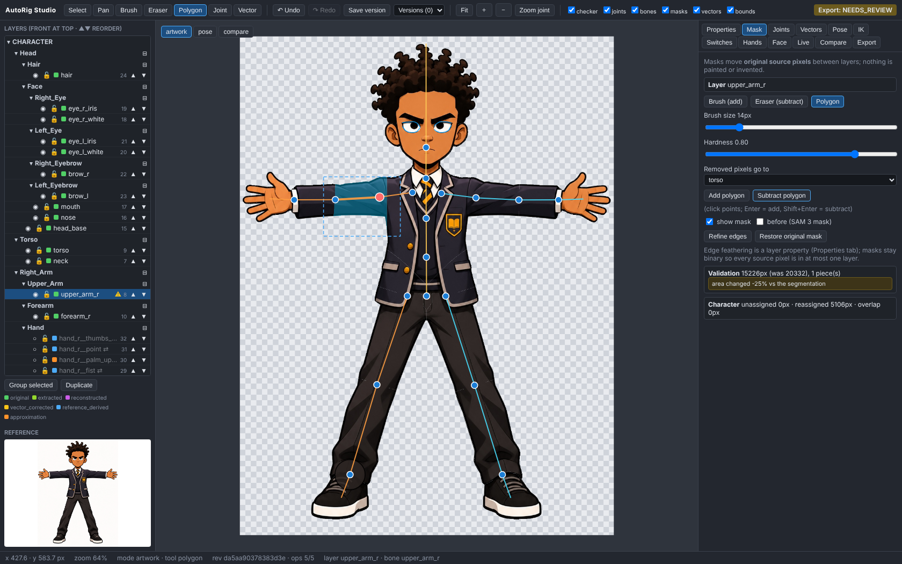

# AutoRig Studio

Turn a single cartoon character reference image into a faithful, **editable
Moho Pro 14 rig**: separated art layers, a bone hierarchy, layer-to-bone
bindings, ready to animate.

> **Status: Phase 3.2 (IK, switch layers and articulated controls): PARTIAL.** Arms and legs can be posed by
> dragging wrist and ankle targets (two-bone IK with poles, limits and FK/IK matching), feet lock to the ground,
> hands switch between drawings with measured wrist alignment, and pose-aware correction switches report missing
> drawings. All hand variants are still pending review and several hand and correction drawings do not exist. Moho
> has not run. See [docs/phase3_2_ik_switch_report.md](docs/phase3_2_ik_switch_report.md).
>
> **Sleeve-free hand replacement: PARTIAL.** The user's sleeve-free hand sheet is extracted into 16 hands (order and
> handedness measured; the two pointing drawings turned out to be the same right hand, so the left one is a flagged
> mirrored copy), imported as a new library that replaces the sleeve-attached hands (archived, restorable), attached by
> a wrist alignment controller and chosen per action by a natural hand selection engine. All drawings are pending
> review; Moho has not run. See [docs/hand_library_replacement_report.md](docs/hand_library_replacement_report.md).
>
> **Hand Pose Store (schoolboy hand pack): PARTIAL.** 16 imported concept hand drawings are stored with the
> character, attached at the cuff of either wrist, masked against duplicate cuffs and selectable in the editor's
> Hands tab. They stay pending review. See [docs/hand_pose_store_integration.md](docs/hand_pose_store_integration.md).
>
> **Phase 3.1 (natural motion and clothing deformation): PARTIAL.** Posing is now split into a motion planner,
> an anatomical solver (IK, foot contact, balance, no bone scaling), a garment-aware deformation engine and
> measurable checks, with a phase-driven front-view walk and run. Nothing is visually approved yet, and Moho has not
> run. See [docs/phase3_1_natural_motion_report.md](docs/phase3_1_natural_motion_report.md).
>
> **Phase 3 (interactive artwork editor and Moho-ready asset package): PARTIAL.** A browser editor
> (React + Konva on a FastAPI backend) corrects layers, masks, pivots and vector shapes on the user's real character,
> previews natural poses and exports a validated asset package. It was tested in a real (headless) browser. Nothing
> generated has been reviewed by a person yet, so the package is not production-ready. See
> [docs/phase3_report.md](docs/phase3_report.md).
>
> **Phases 1 and 2 (analysis, reconstruction, natural posing): PARTIAL.** They ran on the user's real T-pose reference
> with SAM 3 and FLUX inpainting. All generated pixels are pending review. See [docs/real_artwork_test.md](docs/real_artwork_test.md).
>
> **Phase 0 (Moho rigging proof of concept): PARTIAL.** Everything that can run without Moho passes in the cloud
> (340 tests across all phases). The native Moho run is **NOT EXECUTED** yet; it has to happen on the Mac. See
> [the completion report](docs/phase0/completion-report.md).


*Python simulation of the Phase 0 rig (layer binding + forward kinematics).
This is not a Moho render.*

## How Phase 0 works

```
rig_spec.json ──► autorig (Python 3.12) ──► AutoRig_Phase0_Build.lua ──► Moho Pro 14 (Lua 5.4)
  bones in px        geometry → Moho units      menu script, absolute        builds layers, bones,
  parts, z-order     art layers (PNG + SVG)     asset path baked in          bindings, 36-frame keys
  36-frame keys      expected values                                         ▼
                     preview (simulation)                          phase0_moho_report.json
                          ▲                                                  │ (read back from Moho)
                          └──────────── autorig verify-report ◄──────────────┘
```

- **4 transparent art layers** (`torso`, `head`, `upper_arm`, `forearm`), full-canvas 1920×1080 PNG plus SVG sources.
- **Rig spec** in JSON, validated by a JSON Schema and semantic checks.
- **Generated Lua menu script** that creates the bone layer, 4 bones (torso → head, torso → upper_arm → forearm), 4 image layers, the bindings and the animation keys.
- **36-frame test animation**: torso sway, head counter-tilt, two arm waves, loopable.
- **Verification loop**: the script reads the rig back from Moho and writes JSON, and `verify-report` checks it against the spec.
- **Strict mock Moho API**: cloud tests run the generated Lua under Lua 5.4 against a mock that rejects any API member without documented evidence.

## Quick start (cloud or Mac)

```bash
python3.12 -m venv .venv
.venv/bin/pip install -e '.[dev]'
.venv/bin/python -m pytest
```

## Phase 1: analyse a reference image

```bash
export REPLICATE_API_TOKEN=...   # never commit it
.venv/bin/python -m autorig analyze path/to/reference.png --out character_projects/name --budget-usd 1.00
```

This writes `character_project/`: source copy, `analysis/*.json`, masks, original-pixel layers,
previews and `metadata.json`. To try it without paid inference, use the synthetic ground-truth character:
`--provider fixture` on `examples/phase1_synthetic_character/synthetic_fixture.png`.


*Synthetic test character (not a reference). Anatomical parts, joints and bones from the Phase 1 pipeline.*

## Phase 2: reconstruct hidden artwork

```bash
.venv/bin/python -m autorig prepare character_projects/name --out character_packages/name
.venv/bin/python -m autorig review character_packages/name --list
```

Open `character_packages/name/reports/visual_review.html` to inspect generated (magenta) regions and pose tests.


*Synthetic test character posed by the standalone preview engine. Red = remaining gaps that the QA reports. This is not a Moho render.*

## Phase 3: edit the character in the browser

Run these from the repository folder. The first copy puts a working copy of the package next to the repository
(`../schoolboy_pkg`), so the committed snapshot stays untouched:

```bash
.venv/bin/pip install -e '.[dev]'
cp -R projects/schoolboy_tpose/character_package ../schoolboy_pkg
.venv/bin/python -m autorig editor ../schoolboy_pkg
```

Open <http://127.0.0.1:8765>. Edits are saved to `../schoolboy_pkg/editor/`, and the package's own artwork is never
modified. Press Ctrl+C in the terminal to stop the editor. The built editor is committed in `editor/dist`, so Node is
only needed to change the frontend. Export the Moho-ready asset package from the Export tab, or:

```bash
.venv/bin/python -m autorig export-assets ../schoolboy_pkg --out ../schoolboy_export
```



*Real browser screenshot of the editor (headless Chromium), not a Moho render.*

## Running it in Moho Pro 14 (Mac)

Read **[docs/phase0/install-macos-moho14.md](docs/phase0/install-macos-moho14.md)**. In short:

```bash
tools/macos/install_phase0.sh --custom-content "<your Moho Custom Content Folder>"
```

Restart Moho, create a new 1920×1080 document, then run **Scripts → AutoRig → AutoRig Phase 0: Build Test Rig**. After that:

```bash
.venv/bin/python -m autorig verify-report examples/phase0_test_character/rig_spec.json examples/phase0_test_character/phase0_moho_report.json
```

Then work through [docs/phase0/manual-verification.md](docs/phase0/manual-verification.md).

## Documentation

| Document | Contents |
|---|---|
| [docs/architecture.md](docs/architecture.md) | Pipeline, components, coordinate systems, verification layers, roadmap |
| [docs/moho-lua-api-evidence.md](docs/moho-lua-api-evidence.md) | Every Moho API member used, with evidence and open questions |
| [docs/mohomcp-assessment.md](docs/mohomcp-assessment.md) | What MohoMCP can and cannot do for this project |
| [docs/live-models.md](docs/live-models.md) | Moho 14.5 Live Models: findings, unknowns, design, discovery protocol |
| [docs/phase1_report.md](docs/phase1_report.md) | Phase 1 results, Replicate usage and costs, accuracy, readiness, verdict |
| [docs/phase2_implementation_plan.md](docs/phase2_implementation_plan.md) | Phase 2 architecture, model selection, risks, acceptance tests |
| [docs/phase2_report.md](docs/phase2_report.md) | Phase 2 results: preservation, reconstruction vs GT, poses, readiness, verdict |
| [docs/real_artwork_test.md](docs/real_artwork_test.md) | First runs on the user's real character (front crop, then T-pose) |
| [docs/phase2_natural_pose_refinement.md](docs/phase2_natural_pose_refinement.md) | Natural posing: root causes, skinned joints, IK/balance, presets, before/after |
| [docs/phase3_implementation_plan.md](docs/phase3_implementation_plan.md) | Phase 3 audit, components, canvas library comparison, rules, acceptance criteria |
| [docs/phase3_report.md](docs/phase3_report.md) | Phase 3 results: editor, tests, screenshots, fidelity, poses, export gates, verdict |
| [docs/phase3_1_motion_audit.md](docs/phase3_1_motion_audit.md) | Root-cause audit of the Phase 3 poses (confirmed defects vs hypotheses) |
| [docs/phase3_1_natural_motion_report.md](docs/phase3_1_natural_motion_report.md) | Phase 3.1 results: architecture, gait, garments, checks, before/after, performance, verdict |
| [docs/phase3_2_implementation_plan.md](docs/phase3_2_implementation_plan.md) | Phase 3.2 audit and plan: IK, switch groups, hand library, rig controls, migration |
| [docs/phase3_2_ik_switch_report.md](docs/phase3_2_ik_switch_report.md) | Phase 3.2 results: IK, contacts, switches, editor, tests, evidence, performance, verdict |
| [docs/hand_pose_store_integration.md](docs/hand_pose_store_integration.md) | Hand Pose Store: pack import, wrist matching, cuff masking, Hand Library, switch manifest, verdict |
| [docs/hand_library_replacement_report.md](docs/hand_library_replacement_report.md) | Sleeve-free hand library: extraction, handedness, wrist alignment, natural hand selection, 14 gates, verdict |
| [docs/phase0/install-macos-moho14.md](docs/phase0/install-macos-moho14.md) | Installation and run guide for macOS |
| [docs/phase0/manual-verification.md](docs/phase0/manual-verification.md) | Native checks to perform in Moho |
| [docs/phase0/completion-report.md](docs/phase0/completion-report.md) | Phase 0 results and verdict |
| [CLAUDE.md](CLAUDE.md) | Rules for AI-assisted development in this repo |

## Roadmap

| Phase | Scope | State |
|---|---|---|
| 0 | Moho rigging proof of concept (this repo) | Implemented; **awaiting local Moho verification** |
| LM | Moho 14.5 Live Models: Smart Bones and actions mapped to webcam and gamepad inputs | LM-0 (research and discovery tools) done; LM-1 blocked on Phase 0 and the Mac discovery data |
| 1 | AI character analysis: SAM 3 (Replicate) segmentation, anatomy, face, original-pixel layers, live-control contract | Implemented; **PARTIAL** (needs Replicate credit and the real reference image) |
| 2 | Occlusion analysis, pixel-preserving reconstruction, joint preparation, pose QA, live artwork manifest, review workflow | Implemented; **PARTIAL** (inpainting untested; synthetic evidence only) |
| 2+ | Natural posing (skinned joints, IK/balance, presets), corrective hands and gussets | Done on real art; pending review |
| 3 | Interactive editor (layers, masks, pivots, vectors, pose preview, comparison, readiness) and Moho-ready asset package | Implemented; **PARTIAL** (reviews pending; Moho not run) |
| 3.1 | Natural motion: planner/solver split, front-view gait cycles, garment deformation, feasibility and quality checks | Implemented; **PARTIAL** (visual review pending; Moho not run) |
| 3.2 | IK (arms, legs, poles, FK/IK matching), foot contacts, switch groups, hand library, correction triggers, rig controls spec | Implemented; **PARTIAL** (hand variants pending review; drawings missing; Moho not run) |
| 4 | Native Moho import and rig of the exported package | Not started (needs Phase 0 verification, reviews, missing artwork) |
