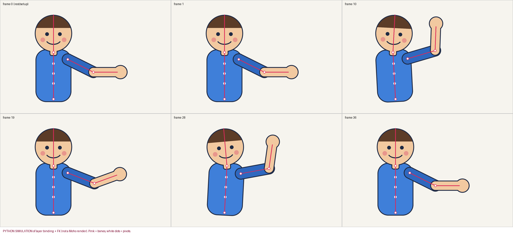

# AutoRig Studio

Turn a single cartoon character reference image into a faithful, **editable
Moho Pro 14 rig**: separated art layers, a bone hierarchy, layer-to-bone
bindings, ready to animate.

> **Status: Phase 0 (Moho rigging proof of concept): PARTIAL.**
> Everything that can run without Moho is implemented and passes in the cloud
> (189 tests, Live Models tooling included). The native Moho run is **NOT EXECUTED** yet; it has to happen on
> the Mac. See [the completion report](docs/phase0/completion-report.md).



*Python simulation of the Phase 0 rig (layer binding + forward kinematics).
This is not a Moho render.*

## How Phase 0 works

```
rig_spec.json ──► autorig (Python 3.12) ──► AutoRig_Phase0_Build.lua ──► Moho Pro 14 (Lua 5.4)
  bones in px        geometry → Moho units      menu script, absolute        builds layers, bones,
  parts, z-order     art layers (PNG + SVG)     asset path baked in          bindings, 36-frame keys
  36-frame keys      expected values                                         ▼
                     preview (simulation)                          phase0_moho_report.json
                          ▲                                                  │ (read back from Moho)
                          └──────────── autorig verify-report ◄──────────────┘
```

- **4 transparent art layers** (`torso`, `head`, `upper_arm`, `forearm`), full-canvas 1920×1080 PNG plus SVG sources.
- **Rig spec** in JSON, validated by a JSON Schema and semantic checks.
- **Generated Lua menu script** that creates the bone layer, 4 bones (torso → head, torso → upper_arm → forearm), 4 image layers, the bindings and the animation keys.
- **36-frame test animation**: torso sway, head counter-tilt, two arm waves, loopable.
- **Verification loop**: the script reads the rig back from Moho and writes JSON, and `verify-report` checks it against the spec.
- **Strict mock Moho API**: cloud tests run the generated Lua under Lua 5.4 against a mock that rejects any API member without documented evidence.

## Quick start (cloud or Mac)

```bash
python3.12 -m venv .venv
.venv/bin/pip install -e '.[dev]'
.venv/bin/python -m pytest
```

## Running it in Moho Pro 14 (Mac)

Read **[docs/phase0/install-macos-moho14.md](docs/phase0/install-macos-moho14.md)**. In short:

```bash
tools/macos/install_phase0.sh --custom-content "<your Moho Custom Content Folder>"
```

Restart Moho, create a new 1920×1080 document, then run **Scripts → AutoRig → AutoRig Phase 0: Build Test Rig**. After that:

```bash
.venv/bin/python -m autorig verify-report examples/phase0_test_character/rig_spec.json examples/phase0_test_character/phase0_moho_report.json
```

Then work through [docs/phase0/manual-verification.md](docs/phase0/manual-verification.md).

## Documentation

| Document | Contents |
|---|---|
| [docs/architecture.md](docs/architecture.md) | Pipeline, components, coordinate systems, verification layers, roadmap |
| [docs/moho-lua-api-evidence.md](docs/moho-lua-api-evidence.md) | Every Moho API member used, with evidence and open questions |
| [docs/mohomcp-assessment.md](docs/mohomcp-assessment.md) | What MohoMCP can and cannot do for this project |
| [docs/live-models.md](docs/live-models.md) | Moho 14.5 Live Models: findings, unknowns, design, discovery protocol |
| [docs/phase0/install-macos-moho14.md](docs/phase0/install-macos-moho14.md) | Installation and run guide for macOS |
| [docs/phase0/manual-verification.md](docs/phase0/manual-verification.md) | Native checks to perform in Moho |
| [docs/phase0/completion-report.md](docs/phase0/completion-report.md) | Phase 0 results and verdict |
| [CLAUDE.md](CLAUDE.md) | Rules for AI-assisted development in this repo |

## Roadmap

| Phase | Scope | State |
|---|---|---|
| 0 | Moho rigging proof of concept (this repo) | Implemented; **awaiting local Moho verification** |
| LM | Moho 14.5 Live Models: Smart Bones and actions mapped to webcam and gamepad inputs | LM-0 (research and discovery tools) done; LM-1 blocked on Phase 0 and the Mac discovery data |
| 1 | SAM 3 segmentation (Replicate) of a reference image into part layers | Blocked on Phase 0 |
| 2+ | Joint/pivot estimation, hybrid bitmap/vector art, MohoMCP-driven verification | Not started |
