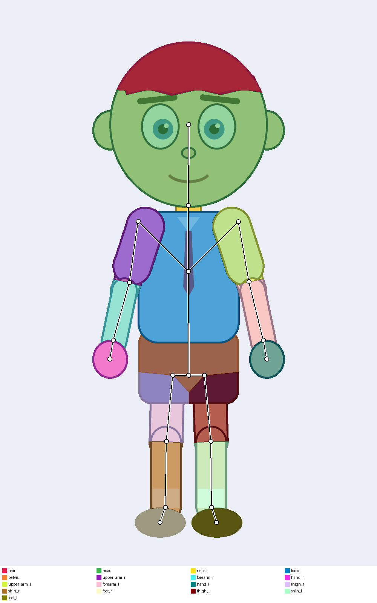
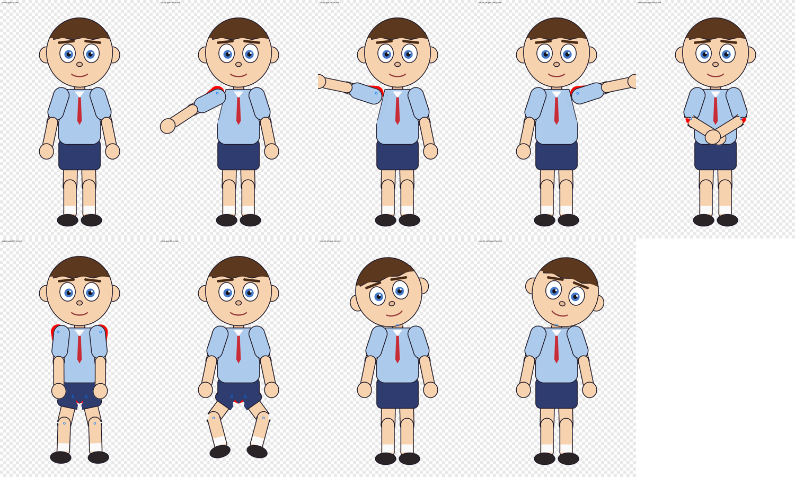

# AutoRig Studio

Turn a single cartoon character reference image into a faithful, **editable
Moho Pro 14 rig**: separated art layers, a bone hierarchy, layer-to-bone
bindings, ready to animate.

> **Status: Phase 3.2 (IK, switch layers and articulated controls): PARTIAL.** Arms and legs can be posed by
> dragging wrist and ankle targets (two-bone IK with poles, limits and FK/IK matching), feet lock to the ground,
> hands switch between drawings with measured wrist alignment, and pose-aware correction switches report missing
> drawings. All hand variants are still pending review and several hand and correction drawings do not exist. Moho
> has not run. See [docs/phase3_2_ik_switch_report.md](docs/phase3_2_ik_switch_report.md).
>
> **Sleeve-free hand replacement: PARTIAL.** The user's sleeve-free hand sheet is extracted into 16 hands (order and
> handedness measured; the two pointing drawings turned out to be the same right hand, so the left one is a flagged
> mirrored copy), imported as a new library that replaces the sleeve-attached hands (archived, restorable), attached by
> a wrist alignment controller and chosen per action by a natural hand selection engine. All drawings are pending
> review; Moho has not run. See [docs/hand_library_replacement_report.md](docs/hand_library_replacement_report.md).
>
> **Hand Pose Store (schoolboy hand pack): PARTIAL.** 16 imported concept hand drawings are stored with the
> character, attached at the cuff of either wrist, masked against duplicate cuffs and selectable in the editor's
> Hands tab. They stay pending review. See [docs/hand_pose_store_integration.md](docs/hand_pose_store_integration.md).
>
> **Phase 3.1 (natural motion and clothing deformation): PARTIAL.** Posing is now split into a motion planner,
> an anatomical solver (IK, foot contact, balance, no bone scaling), a garment-aware deformation engine and
> measurable checks, with a phase-driven front-view walk and run. Nothing is visually approved yet, and Moho has not
> run. See [docs/phase3_1_natural_motion_report.md](docs/phase3_1_natural_motion_report.md).
>
> **Phase 3 (interactive artwork editor and Moho-ready asset package): PARTIAL.** A browser editor
> (React + Konva on a FastAPI backend) corrects layers, masks, pivots and vector shapes on the user's real character,
> previews natural poses and exports a validated asset package. It was tested in a real (headless) browser. Nothing
> generated has been reviewed by a person yet, so the package is not production-ready. See
> [docs/phase3_report.md](docs/phase3_report.md).
>
> **Phases 1 and 2 (analysis, reconstruction, natural posing): PARTIAL.** They ran on the user's real T-pose reference
> with SAM 3 and FLUX inpainting. All generated pixels are pending review. See [docs/real_artwork_test.md](docs/real_artwork_test.md).
>
> **Phase 0 (Moho rigging proof of concept): PARTIAL.** Everything that can run without Moho passes in the cloud
> (340 tests across all phases). The native Moho run is **NOT EXECUTED** yet; it has to happen on the Mac. See
> [the completion report](docs/phase0/completion-report.md).


*Python simulation of the Phase 0 rig (layer binding + forward kinematics).
This is not a Moho render.*

## How Phase 0 works

```
rig_spec.json ──► autorig (Python 3.12) ──► AutoRig_Phase0_Build.lua ──► Moho Pro 14 (Lua 5.4)
  bones in px        geometry → Moho units      menu script, absolute        builds layers, bones,
  parts, z-order     art layers (PNG + SVG)     asset path baked in          bindings, 36-frame keys
  36-frame keys      expected values                                         ▼
                     preview (simulation)                          phase0_moho_report.json
                          ▲                                                  │ (read back from Moho)
                          └──────────── autorig verify-report ◄──────────────┘
```

- **4 transparent art layers** (`torso`, `head`, `upper_arm`, `forearm`), full-canvas 1920×1080 PNG plus SVG sources.
- **Rig spec** in JSON, validated by a JSON Schema and semantic checks.
- **Generated Lua menu script** that creates the bone layer, 4 bones (torso → head, torso → upper_arm → forearm), 4 image layers, the bindings and the animation keys.
- **36-frame test animation**: torso sway, head counter-tilt, two arm waves, loopable.
- **Verification loop**: the script reads the rig back from Moho and writes JSON, and `verify-report` checks it against the spec.
- **Strict mock Moho API**: cloud tests run the generated Lua under Lua 5.4 against a mock that rejects any API member without documented evidence.

## Quick start (cloud or Mac)

```bash
python3.12 -m venv .venv
.venv/bin/pip install -e '.[dev]'
.venv/bin/python -m pytest
```

## Phase 1: analyse a reference image

```bash
export REPLICATE_API_TOKEN=...   # never commit it
.venv/bin/python -m autorig analyze path/to/reference.png --out character_projects/name --budget-usd 5.00
```

This writes `character_project/`: source copy, `analysis/*.json`, masks, original-pixel layers,
previews and `metadata.json`. To try it without paid inference, use the synthetic ground-truth character:
`--provider fixture` on `examples/phase1_synthetic_character/synthetic_fixture.png`.



*Synthetic test character (not a reference). Anatomical parts, joints and bones from the Phase 1 pipeline.*

## Phase 2: reconstruct hidden artwork

```bash
.venv/bin/python -m autorig prepare character_projects/name --out character_packages/name
.venv/bin/python -m autorig review character_packages/name --list
```

Open `character_packages/name/reports/visual_review.html` to inspect generated (magenta) regions and pose tests.



*Synthetic test character posed by the standalone preview engine. Red = remaining gaps that the QA reports. This is not a Moho render.*

## Phase 3: edit the character in the browser

Run these from the repository folder. The first copy puts a working copy of the package next to the repository
(`../schoolboy_pkg`), so the committed snapshot stays untouched:

```bash
.venv/bin/pip install -e '.[dev]'
cp -R projects/schoolboy_tpose/character_package ../schoolboy_pkg
.venv/bin/python -m autorig editor ../schoolboy_pkg
```

Open <http://127.0.0.1:8765>. Edits are saved to `../schoolboy_pkg/editor/`, and the package's own artwork is never
modified. Press Ctrl+C in the terminal to stop the editor. The built editor is committed in `editor/dist`, so Node is
only needed to change the frontend. Export the Moho-ready asset package from the Export tab, or:

```bash
.venv/bin/python -m autorig export-assets ../schoolboy_pkg --out ../schoolboy_export
```

The **Weights** tab (Phase 3.3) shows the garment parts and each bone's influence, and lets you paint, smooth or lock
garment weights; edits are project operations and never change the artwork. Before/after garment renders:

```bash
.venv/bin/python -m autorig garment-evidence ../schoolboy_pkg
```

The **Correctives** tab (Phase 3.4) lists the corrective artwork built from the character's own pixels:
- armpit gussets;
- shoe tops under the trouser hem;
- elbow and knee caps;
- edge decontamination.

Each asset shows its provenance, versions and approval state, with a before/after preview in the current pose. You can approve, reject, disable, change the blend strength and activation range, or replace a drawing with your own. Every generated asset is pending review until you approve it. To build the assets and their evidence:

```bash
.venv/bin/python -m autorig corrective-evidence ../schoolboy_pkg
```

The **Artistic** tab (Phase 3.5) lets you compare pose candidates as clean renders and silhouettes, and see the
artwork each one uses. You can approve, reject or choose a pose, save templates, and give feedback ("Move the hand
farther from the torso"); the feedback is stored as structured constraints. To build the before/after evidence and
the acting test:

```bash
.venv/bin/python -m autorig artistic-evidence ../schoolboy_pkg
```

The **Performance** tab (Phase 3.6) edits animation on a timeline:
- **Edit:**
  - key poses with holds and per-key timing curves (ease, Bezier, hold, Hermite pass-through keys);
  - anticipation recipes and overshoot;
  - gesture clips from a reusable library;
  - hand-contact markers and hand switch markers;
  - motion layers (mute/weight);
  - acting styles;
  - hair and blazer-hem secondary motion.
- **Play back:** scrub and play the fast skeleton preview, and render single frames or whole animations with the
  full artwork.
- **Save:** edits are project operations, so undo/redo and reload keep them.

To build the Phase 3.6 evidence:
- the frame-aligned before/after acting test;
- the classroom desk-contact test;
- the secondary-motion demo;
- a benchmark.

```bash
.venv/bin/python -m autorig performance-evidence ../schoolboy_pkg
.venv/bin/python -m autorig performance-bench ../schoolboy_pkg   # timings on this machine (e.g. the Apple M1)
```

Phase 3.7 adds two tabs.

The **Hand Inspector** tab shows why each hand drawing was chosen for the current pose or performance frame:
- the drawing's handedness, palm view and rotation from how it was drawn;
- the wrist checks and the approval state;
- every rejected drawing with the rule it failed;
- any missing artwork.

From the same tab you can override the choice or correct a drawing's metadata. Hands are chosen by hard rules first:
- the right hand;
- an approved drawing in production;
- a palm that faces the way the gesture needs;
- no flat rotation beyond what the drawing tolerates.

A camera-facing palm is never rotated into a fake "palm up": the shrug with palms up reports NEEDS_ARTWORK until a
palm-up drawing is drawn and approved.

The **Ref Motion** tab turns a reference (video, GIF, image sequence, AutoRig JSON or BVH, with a permission
statement) into a performance for your character:
- pose estimation runs locally (MediaPipe);
- angles are retargeted onto the character's own proportions;
- motion toward or away from the camera is reported as needing new artwork or a new view, never stretched.

The rule-based critic lists defects as hypotheses. A bounded revision loop can propose a correction, and nothing is
applied or approved without you.

```bash
.venv/bin/python -m autorig hand-audit ../schoolboy_pkg --inspection references/schoolboy/hand_pack_v2/semantic_inspection.json
.venv/bin/python -m autorig hand-selection-evidence ../schoolboy_pkg
.venv/bin/pip install -e '.[reference]' && .venv/bin/python -m autorig reference-models --download
.venv/bin/python -m autorig reference-import clip.mp4 --id my_point --source "my own recording" --permission "mine, for animation reference" --hand r=pointing
.venv/bin/python -m autorig reference-evidence ../schoolboy_pkg
.venv/bin/python -m autorig phase37-bench ../schoolboy_pkg
```

Phase 3.8 runs the whole workflow on a second, previously unseen character and a new hand library.
- Inputs: the T-pose "tough student" in `references/tough_student/`, and a 16-hand gesture grid on a black
  background.
- Project: `projects/tough_student_test/`.
- Evidence: `docs/phase3_8/new_character_evidence/`.

Hand sheets on a dark background are now supported. The outline is grown from the drawing's colours, so black
outlines are never deleted with the background.

The second character exposed several schoolboy-specific assumptions. Some were fixed; the colour-based garment
labelling is documented in [docs/phase3_8_generalisation_report.md](docs/phase3_8_generalisation_report.md).

Phase 3.8.1 fixed the visual defects found on that character, generally and on both characters:
- resting hands (re-inspected relaxed drawings and an anatomical rule for hanging arms);
- requested vs rendered hand switches;
- layer-independent garment weights at the shoulder;
- the armpit seam;
- knee limits during weight shifts;
- measured garment semantics.

Artwork problems became reviewable candidates, never applied or approved. Before/after evidence is in
`docs/phase3_8_1/`, regenerated with `autorig visual-fix-evidence`.

```bash
.venv/bin/python -m autorig analyze references/tough_student/tpose_front.jpg --out ../ts_project --character-id tough_student --complete-outline 5
.venv/bin/python -m autorig prepare ../ts_project --out ../ts_pkg --provider flux-fill-dev --candidates 1
.venv/bin/python -m autorig hand-sheet references/tough_student/hand_grid/hand_grid_black.jpg --inspection references/tough_student/hand_grid/inspection.json --out ../ts_hands --library-id tough_student_hands_v1
.venv/bin/python -m autorig newchar-evidence ../ts_pkg --project ../ts_project --character references/tough_student/tpose_front.jpg --hand-sheet references/tough_student/hand_grid/hand_grid_black.jpg --hand-grid ../ts_hands --out ../ts_evidence
```


*Real browser screenshot of the editor (headless Chromium), not a Moho render.*

## Phase 4: native Moho (blocked on the Mac run)

Phase 4.0 is the smallest native proof, built from either character package. A rig with a `body`, a `shoulder` and an
`arm` bone holds the character's own pixels, unscaled. The Mac run:
- builds it in Moho;
- saves it, closes it and reopens it;
- moves the arm again;
- renders three frames.

`autorig native-verify` then checks HARD GATE 4.0 on that evidence. The first native runs (Moho 14.5.1) built and
saved the rig, but did not reopen or render it. Phase 4.0 is **PARTIAL**, with 2 of 5 gate items passed
([docs/phase4_completion_report.md](docs/phase4_completion_report.md)). On the Mac:

```bash
tools/macos/phase4_native_test.sh --custom-content "<your Moho Custom Content Folder>"
```

Phase 4.1 builds the full-body rig with `autorig native-fullbody`, for any character package:
- 25 semantic bones from the character's own skeleton;
- every layer unscaled, one bone each;
- twelve test poses;
- an opt-in IK/limits experiment.

Phase 4.0 is still incomplete, so Phase 4.1 is **BLOCKED — native validation required**; nothing has run in Moho yet
([docs/phase4_1_implementation_report.md](docs/phase4_1_implementation_report.md)). On the Mac, after Phase 4.0:

```bash
tools/macos/phase4_native_test.sh --phase 4.1 --with-ik --custom-content "<your Moho Custom Content Folder>"
```

## Running it in Moho Pro 14 (Mac)

Read **[docs/phase0/install-macos-moho14.md](docs/phase0/install-macos-moho14.md)**. In short:

```bash
tools/macos/install_phase0.sh --custom-content "<your Moho Custom Content Folder>"
```

Restart Moho, create a new 1920×1080 document, then run **Scripts → AutoRig → AutoRig Phase 0: Build Test Rig**. After that:

```bash
.venv/bin/python -m autorig verify-report examples/phase0_test_character/rig_spec.json examples/phase0_test_character/phase0_moho_report.json
```

Then work through [docs/phase0/manual-verification.md](docs/phase0/manual-verification.md).

## Documentation

| Document | Contents |
|---|---|
| [docs/architecture.md](docs/architecture.md) | Pipeline, components, coordinate systems, verification layers, roadmap |
| [docs/moho-lua-api-evidence.md](docs/moho-lua-api-evidence.md) | Every Moho API member used, with evidence and open questions |
| [docs/mohomcp-assessment.md](docs/mohomcp-assessment.md) | What MohoMCP can and cannot do for this project |
| [docs/live-models.md](docs/live-models.md) | Moho 14.5 Live Models: findings, unknowns, design, discovery protocol |
| [docs/phase1_report.md](docs/phase1_report.md) | Phase 1 results, Replicate usage and costs, accuracy, readiness, verdict |
| [docs/phase2_implementation_plan.md](docs/phase2_implementation_plan.md) | Phase 2 architecture, model selection, risks, acceptance tests |
| [docs/phase2_report.md](docs/phase2_report.md) | Phase 2 results: preservation, reconstruction vs GT, poses, readiness, verdict |
| [docs/real_artwork_test.md](docs/real_artwork_test.md) | First runs on the user's real character (front crop, then T-pose) |
| [docs/phase2_natural_pose_refinement.md](docs/phase2_natural_pose_refinement.md) | Natural posing: root causes, skinned joints, IK/balance, presets, before/after |
| [docs/phase3_implementation_plan.md](docs/phase3_implementation_plan.md) | Phase 3 audit, components, canvas library comparison, rules, acceptance criteria |
| [docs/phase3_report.md](docs/phase3_report.md) | Phase 3 results: editor, tests, screenshots, fidelity, poses, export gates, verdict |
| [docs/phase3_1_motion_audit.md](docs/phase3_1_motion_audit.md) | Root-cause audit of the Phase 3 poses (confirmed defects vs hypotheses) |
| [docs/phase3_1_natural_motion_report.md](docs/phase3_1_natural_motion_report.md) | Phase 3.1 results: architecture, gait, garments, checks, before/after, performance, verdict |
| [docs/phase3_2_implementation_plan.md](docs/phase3_2_implementation_plan.md) | Phase 3.2 audit and plan: IK, switch groups, hand library, rig controls, migration |
| [docs/phase3_2_ik_switch_report.md](docs/phase3_2_ik_switch_report.md) | Phase 3.2 results: IK, contacts, switches, editor, tests, evidence, performance, verdict |
| [docs/hand_pose_store_integration.md](docs/hand_pose_store_integration.md) | Hand Pose Store: pack import, wrist matching, cuff masking, Hand Library, switch manifest, verdict |
| [docs/hand_library_replacement_report.md](docs/hand_library_replacement_report.md) | Sleeve-free hand library: extraction, handedness, wrist alignment, natural hand selection, 14 gates, verdict |
| [docs/phase3_3_clothing_audit.md](docs/phase3_3_clothing_audit.md) | Root causes of the garment distortion (renders + code) |
| [docs/phase3_3_clothing_deformation_report.md](docs/phase3_3_clothing_deformation_report.md) | Phase 3.3 garment rig: parts, pivots, weights, rigid segments, correctives, evaluator, Weights tab, before/after, Moho matrix, verdict |
| [docs/phase3_4_baseline_audit.md](docs/phase3_4_baseline_audit.md) | Phase 3.3 defects reproduced on the real character before Phase 3.4 |
| [docs/phase3_4_corrective_artwork_report.md](docs/phase3_4_corrective_artwork_report.md) | Phase 3.4: corrective artwork, original-pixel safety, pose-space activation, Correctives tab, before/after, verdict |
| [docs/phase3_5_artistic_quality_audit.md](docs/phase3_5_artistic_quality_audit.md) | Phase 3.4 renders audited as character animation (causes of unnatural poses) |
| [docs/phase3_5_artistic_animation_report.md](docs/phase3_5_artistic_animation_report.md) | Phase 3.5: artistic pose planning, silhouettes, feasibility, alternatives, layer order, acting test, verdict |
| [docs/phase3_6_implementation_plan.md](docs/phase3_6_implementation_plan.md) | Phase 3.6 audit of the animation systems (incl. the planted-foot slide) and plan |
| [docs/phase3_6_expressive_animation_report.md](docs/phase3_6_expressive_animation_report.md) | Phase 3.6: performance engine, contacts, curves, secondary motion, timeline editor, verdict |
| [docs/phase3_7_implementation_plan.md](docs/phase3_7_implementation_plan.md) | Phase 3.7 plan: hand selection, reference motion, critique, editor |
| [docs/phase3_7_hand_selection_audit.md](docs/phase3_7_hand_selection_audit.md) | Phase 3.7: the shrug regression traced, every hand drawing audited, constraints, shoulders |
| [docs/phase3_7_reference_motion_architecture.md](docs/phase3_7_reference_motion_architecture.md) | Phase 3.7: reference import, pose estimation, analysis, retargeting, store, critic |
| [docs/phase3_7_visual_quality_report.md](docs/phase3_7_visual_quality_report.md) | Phase 3.7: shrug comparisons, wrist/shoulder close-ups, 10 hand cases, reference comparisons |
| [docs/phase3_7_completion_report.md](docs/phase3_7_completion_report.md) | Phase 3.7: acceptance criteria, verified results, pending approvals, blockers, verdict |
| [docs/phase3_8_new_character_report.md](docs/phase3_8_new_character_report.md) | Phase 3.8: a new character rigged end to end; 26 acceptance criteria; verdict |
| [docs/phase3_8_hand_library_report.md](docs/phase3_8_hand_library_report.md) | Phase 3.8: black-background hand grid extraction, handedness, compatibility, 16 drawings on the character |
| [docs/phase3_8_segmentation_report.md](docs/phase3_8_segmentation_report.md) | Phase 3.8: import, background extraction, anatomy, garment parts, detail preservation |
| [docs/phase3_8_rigging_quality_report.md](docs/phase3_8_rigging_quality_report.md) | Phase 3.8: skeleton, arm lowering, poses, garments, correctives, animation (technical vs artistic) |
| [docs/phase3_8_generalisation_report.md](docs/phase3_8_generalisation_report.md) | Phase 3.8: schoolboy-specific assumptions found, fixed or documented |
| [docs/phase3_8_export_readiness.md](docs/phase3_8_export_readiness.md) | Phase 3.8: the new character's Moho-ready package, what is tested and what needs Moho |
| [docs/phase3_8_1_visual_defect_audit.md](docs/phase3_8_1_visual_defect_audit.md) | Phase 3.8.1: each visual defect traced to its cause (hands, shoulders, armpits, knees, artwork) |
| [docs/phase3_8_1_fix_report.md](docs/phase3_8_1_fix_report.md) | Phase 3.8.1: fixes, candidates, before/after measurements, acceptance gates, verdict |
| [docs/phase3_8_1_moho_readiness.md](docs/phase3_8_1_moho_readiness.md) | Phase 3.8.1: the smallest native Moho test (NOT EXECUTED) |
| [docs/phase0/install-macos-moho14.md](docs/phase0/install-macos-moho14.md) | Installation and run guide for macOS |
| [docs/phase0/manual-verification.md](docs/phase0/manual-verification.md) | Native checks to perform in Moho |
| [docs/phase0/completion-report.md](docs/phase0/completion-report.md) | Phase 0 results and verdict |
| [docs/phase4_native_integration_audit.md](docs/phase4_native_integration_audit.md) | Phase 4: what exists, what is evidenced, what only Moho can confirm |
| [docs/phase4_implementation_plan.md](docs/phase4_implementation_plan.md) | Phase 4: the 4.0 proof, HARD GATE 4.0, and steps 5–23 (not started) |
| [docs/phase4_moho_api_compatibility.md](docs/phase4_moho_api_compatibility.md) | Phase 4: the API members used, and the candidates that are not allowlisted |
| [docs/phase4_native_rig_report.md](docs/phase4_native_rig_report.md) | Phase 4.0: the proof rig for both characters, gate thresholds, cloud (mock) results |
| [docs/phase4_visual_parity_report.md](docs/phase4_visual_parity_report.md) | Phase 4: render comparison method (NOT EXECUTED) |
| [docs/phase4_live_control_readiness.md](docs/phase4_live_control_readiness.md) | Phase 4: Live Mode readiness (not started, blocked) |
| [docs/phase4_completion_report.md](docs/phase4_completion_report.md) | Phase 4: verdict BLOCKED and the exact steps to resume |
| [docs/phase4_1_architecture_plan.md](docs/phase4_1_architecture_plan.md) | Phase 4.1: package audit and the plan, written before the builder |
| [docs/phase4_1_implementation_report.md](docs/phase4_1_implementation_report.md) | Phase 4.1: what was built, gate status, verdict |
| [docs/phase4_1_native_validation.md](docs/phase4_1_native_validation.md) | Phase 4.1: Phase 4.0 status, gates 4.1-A..L, the Mac procedure |
| [docs/phase4_1_rig_architecture.md](docs/phase4_1_rig_architecture.md) | Phase 4.1: skeleton, ranges, coordinates, controls |
| [docs/phase4_1_moho_api_compatibility.md](docs/phase4_1_moho_api_compatibility.md) | Phase 4.1: members used, native status, new allowlist entries |
| [docs/phase4_1_artwork_binding_report.md](docs/phase4_1_artwork_binding_report.md) | Phase 4.1: artwork import, binding classes, garments, hands |
| [docs/phase4_1_performance_report.md](docs/phase4_1_performance_report.md) | Phase 4.1: cloud tooling timings; M1 measurements not executed |
| [CLAUDE.md](CLAUDE.md) | Rules for AI-assisted development in this repo |

## Roadmap

| Phase | Scope | State |
|---|---|---|
| 0 | Moho rigging proof of concept (this repo) | Implemented; **awaiting local Moho verification** |
| LM | Moho 14.5 Live Models: Smart Bones and actions mapped to webcam and gamepad inputs | LM-0 (research and discovery tools) done; LM-1 blocked on Phase 0 and the Mac discovery data |
| 1 | AI character analysis: SAM 3 (Replicate) segmentation, anatomy, face, original-pixel layers, live-control contract | Implemented; **PARTIAL** (needs Replicate credit and the real reference image) |
| 2 | Occlusion analysis, pixel-preserving reconstruction, joint preparation, pose QA, live artwork manifest, review workflow | Implemented; **PARTIAL** (inpainting untested; synthetic evidence only) |
| 2+ | Natural posing (skinned joints, IK/balance, presets), corrective hands and gussets | Done on real art; pending review |
| 3 | Interactive editor (layers, masks, pivots, vectors, pose preview, comparison, readiness) and Moho-ready asset package | Implemented; **PARTIAL** (reviews pending; Moho not run) |
| 3.1 | Natural motion: planner/solver split, front-view gait cycles, garment deformation, feasibility and quality checks | Implemented; **PARTIAL** (visual review pending; Moho not run) |
| 3.2 | IK (arms, legs, poles, FK/IK matching), foot contacts, switch groups, hand library, correction triggers, rig controls spec | Implemented; **PARTIAL** (hand variants pending review; drawings missing; Moho not run) |
| 4 | Native Moho rig generation | 4.0 built; first native runs in Moho 14.5.1: build and save pass, reopen and renders pending; **PARTIAL** (2/5 gate items) |
| 4.1 | Full-body native rig (25 bones, all layers, IK/limits experiment), 12 native gates | Built and cloud-tested for both characters; **BLOCKED — native validation required**; 4.2 not started |
