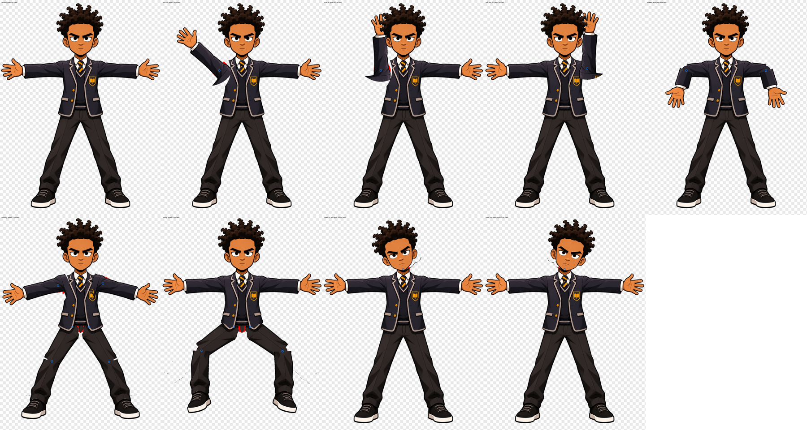
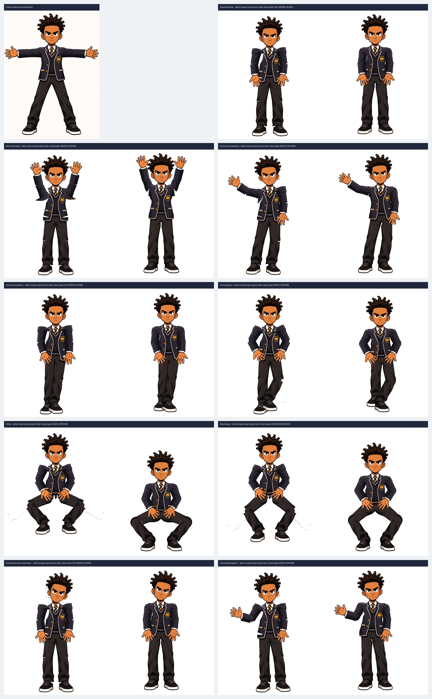
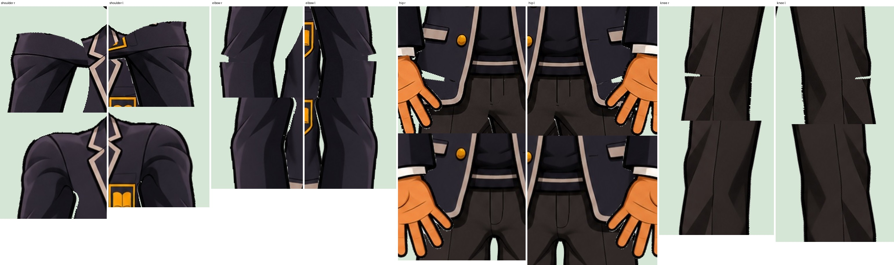

# Phase 2 refinement: natural posing and joint deformation

**Result: posing is visibly better; not ready for Phase 3.**
* Natural poses of the real T-pose character now look clean.
* 5 of 12 presets pass every automatic check, but they still need human review.
* 7 presets are labelled **NEEDS_ARTWORK**, because they need hand shapes or corrective shapes that do
  not exist yet.
* Everything was rendered by the standalone preview deformer. **Moho was not run**, and no generated
  pixel has been human-reviewed.

Inputs: `projects/schoolboy_tpose/character_package` (the user's T-pose reference, real SAM 3
segmentation). The synthetic arms-down character was used to check generality.
Outputs: `projects/schoolboy_tpose/character_package/natural_pose/`. Command:
`python -m autorig pose-refine <package>` (about 65 s for 12 presets).

## 1. Root causes of the unnatural movement

Found by auditing `src/autorig/phase2/pose.py` against the T-pose rig data.

| # | Cause | Where | Visible effect |
|---|---|---|---|
| 1 | One rigid `body` bone holds torso, pelvis and neck, with no pivot | `pose.py` `RIG["body"] = (None, None, [...])` | no spine bend, no pelvis tilt, no shoulder shrug: stiff torso |
| 2 | Each layer moves rigidly with one bone, and layers are cut along straight "nearest bone" lines | `pose.py` `apply()`; Phase 1 partition | every rotation opens the cut lines: wedges and tears at shoulders, hips and knees |
| 3 | A layer's bone decides how all of its pixels move | `pose.py` `bone_of()` | the right upper-arm layer contains jacket (x 420-466 px, down to y 579), so the jacket swings with the arm: the "flap" at the shoulder |
| 4 | The shoulder pivot sits in the sleeve: (390, 475) | Phase 1 `limb_proximal_extreme_inset_by_radius` | 35 px lateral of the armpit and 10 px off the arm axis, with sides 14 px apart: the arm swings around the wrong point |
| 5 | Poses are raw angle offsets from the rest pose: no limits, IK, ground, pelvis height or balance | `pose.py` `POSES` | feet lift or sink when legs rotate; no weight; any angle allowed |
| 6 | The z-order is fixed and asymmetric: right upper arm behind the torso, left in front | Phase 2 occlusion order | the right arm disappears behind the jacket when lowered |
| 7 | The T-pose is the rest pose and the previews were offsets from it | `POSES` | every natural pose needs 75-85 deg shoulder rotations: the hardest case for rigid layers |

## 2. Changes implemented

| Module | What it does |
|---|---|
| `phase2/skeleton.py` | Anatomical skeleton (see the hierarchy below). Pivots are refined against the artwork: the shoulder is found at the **armpit** and re-centred on the arm axis (right shoulder 390,475 -> 406,467); elbows, wrists and knees sit on the limb's medial line. Every pixel gets a **home bone by position** (joint planes and body zones), not by layer, so jacket pixels in the arm layer stay with the chest. Also holds joint limits and per-joint blend bands. |
| `phase2/skinning.py` | **Local skinned deformation.** Most pixels move rigidly: on the T-pose 62-79% of the art keeps its exact original pixels. Near a joint, the rotation angle is interpolated across a blend band; interpolating the angle preserves volume, so there is no pinching. Adjacent layers evaluate the same deformation at their shared border, so cut lines cannot open. Other features: a 1 px "bleed" of the neighbour's original pixels removes resampling hairlines; inverse rendering is seeded from the forward map and refined by Newton steps; fold and stretch statistics; a seam detector. The identity pose is bit-exact. |
| `phase2/posing.py` | Solver: FK for torso, head and arms; analytic **two-bone IK** for planted feet and reach targets; **pelvis height** from leg reach (feet stay on the ground with a soft knee); **centre-of-mass balancing** by pelvis shift to a requested weight split; automatic **torso counter-rotation**; **clavicle shrug**; **pelvis tilt**; joint limits that are clamped or reported, never exceeded silently; axial foreshortening (flagged). Holds the 12 presets. |
| `phase2/pose_eval.py` | Per-pose checks: limits, bone lengths, ground contact, foot targets, centre of mass vs support, visible seams (rest-adjacent pixels torn apart where it can be seen), figure splits, folds and stretch, rigid share, unreviewed generated pixels made visible, limb alignment. Also status, confidence, close-ups and the diagnostic overlay. |
| `phase2/natural.py`, `autorig pose-refine` | Orchestration. "Before" renders use the original rigid engine; adds sequences (squat-down, weight shift), both contact sheets, `rig.json` and `presets.json`. |

Skeleton hierarchy:
* `pelvis` (root, at the hip midpoint)
  * `spine` -> `chest` -> `neck` -> `head`
  * `chest` -> `clavicle_r/l` -> `upper_arm` -> `forearm` -> `hand`
  * `pelvis` -> `thigh` -> `shin` -> `foot`

Other fixes found along the way:
* **Hip fade:** both hips used to pull the crotch apart, so their influence now fades toward the midline.
* **Ear/jaw fragments:** fragments that Phase 1 left in the torso layer now follow the head.
* **Foreshortening:** it now scales only the bone's own pixels. Descendants are translated, which a test
  caught: the shin had been shortened from 272 px to 165 px.

## 3. Tests executed

* **`tests/test_p2_natural_pose.py`, 26 tests:**
  * unit scenes: identity bit-exact; rigid quarter turn keeps the original pixels; a 70 deg bend has no
    seam where rigid layers open a wedge; the inner side folds under the child; two-bone IK reaches and
    honours the bend side; unreachable targets are reported, never stretched;
  * T-pose integration: skeleton structure and refined shoulders; jacket pixels homed to the body;
    facial layers ride the head only;
  * per preset (all 12): no joint-limit violations, no hyperextension, knees never bend medially, bone
    lengths preserved, planted feet on target and flat, centre of mass inside the support within 3 px;
  * out-of-range input clamped **and** reported;
  * squat sequence: 0 px foot drift and the pelvis lowers; the weight shift moves the centre of mass over
    the stance foot;
  * rendered relaxed / walk / head tilt: at most 8 torn pairs, 1 figure piece, ground, balance and
    alignment pass, rigid share above 55%, close-up visual check written;
  * poses needing artwork are labelled NEEDS_ARTWORK;
  * the committed outputs are consistent.
* **Full suite:** see section 9.

## 4. Before and after

The original Phase 2 pose sheet (rigid engine, poses as offsets from the T-pose):

The new contact sheet:
* the original reference comes first;
* each preset shows **the original rigid engine (left) | the natural pose (right)**, using the same limb
  directions;
* the clean presentation has no engineering markers.

The diagnostic version adds bones, pivots, the ground line, the centre of mass, the support base, and
visible tears in red:
[contact_sheet_diagnostic.png](../projects/schoolboy_tpose/character_package/natural_pose/contact_sheet_diagnostic.png).

Close-ups of shoulders, elbows, hips and knees show the rigid engine on top and the natural pose below.
Example: relaxed standing.

## 5. Joint deformation improvements

| Joint | Before (rigid) | After (skinned) |
|---|---|---|
| Shoulder | jacket flap swings with the arm; wedge gap above the shoulder; arm hidden behind the torso | jacket shoulder rounds over the lowered arm; no seam in standing, walking or head tilt; arms in front of the body |
| Elbow | cut line opens on the outside of the bend | continuous outer curve; the inner crease folds under the forearm |
| Hip / crotch | thighs rotate under a fixed pelvis cut; tear at the fly | pelvis influence fades at the midline; the fly outline stays intact (0 torn pairs in standing and walking) |
| Knee | rotation about a midpoint pivot with a visible step | blend band of about 0.55 x leg width; smooth bend in the squat |
| Neck / head | head rotates alone; ear/jaw fragments stay behind | neck and head split the tilt; chest counter-rotates; fragments follow the head |

Quantities for each preset are in `natural_pose/presets.json` and the band sizes in
`natural_pose/rig.json` (`corrections`).

| Preset | Status | Confidence | Torn pairs | Balance error (px) | Rigid share |
|---|---|---|---|---|---|
| Relaxed standing | OK_PENDING_REVIEW | 0.85 | 0 | -0.3 | 0.79 |
| Standing, hands at sides | OK_PENDING_REVIEW | 0.85 | 0 | -0.3 | 0.79 |
| Pointing while speaking | NEEDS_ARTWORK | 0.37 | 33 | 0.3 | 0.62 |
| One-handed shrug | NEEDS_ARTWORK | 0.65 | 18 | 0.2 | 0.68 |
| Both hands raised | NEEDS_ARTWORK | 0.34 | 53 | -0.3 | 0.75 |
| Arms crossed | NEEDS_ARTWORK | 0.09 | 20 | -0.4 | 0.79 |
| Casual walking stance | OK_PENDING_REVIEW | 0.85 | 0 | 0.2 | 0.63 |
| Running stance | NEEDS_ARTWORK | 0.50 | 7 | 0.1 | 0.63 |
| Sitting | NEEDS_ARTWORK | 0.05 | 55 | -0.2 | 0.79 |
| Natural squat | OK_PENDING_REVIEW | 0.90 | 27 (none concentrated at a joint) | -0.2 | 0.79 |
| Head tilt with torso compensation | OK_PENDING_REVIEW | 0.85 | 5 | -0.3 | 0.62 |
| Conversational gesture | NEEDS_ARTWORK | 0.57 | 10 | -0.5 | 0.62 |

Across all presets:
* identity pose exact;
* foot drift 0.0 px in the squat-down and weight-shift sequences;
* no joint-limit violations.

## 6. Remaining visual defects

NEEDS_ARTWORK, not passed:
* **Armpit, arms raised:** the T-pose armpit is a 90 deg background corner, and raising the arm opens it
  into a notch. This needs a corrective armpit gusset. Affects both hands raised, pointing and the gesture.
* **Hand shapes:** pointing hand, palm-up hand and fists do not exist; only open palms facing the viewer.
* **Arms crossed:** the hands stay visible, and the elbow creases tear.
* **Running and sitting:** front-view knee lifts and chair sits need foreshortened thighs. These are
  approximated by axial scaling (0.6) or shown as a wide-knee seat. Sitting also has knee-crease seams and
  6% strong stretch.

Other known issues:
* **Unreviewed generated pixels:** a 165-200 px sliver of the FLUX torso fill (jacket fabric under the
  left arm) becomes visible in standing poses. It is reported per pose. The bad fills (neck with face
  features, thigh button) stay hidden in all presets.
* **The front view limits depth motion:** walking reads as a weight shift and passing leg, not a stride.
* **Synthetic character:** its separately drawn puffy sleeves leave white shoulder seams, so most presets
  are NEEDS_ARTWORK there. The solver itself generalises; the corrective needs are reported.

## 7. Moho compatibility implications (proposed, not verified)

* **Bones:** `natural_pose/rig.json` lists bones (head and tail in source px, parent, length, limits),
  layer bindings (home bones) and per-joint correction presets. These map to:
  * Moho bones, using the Phase 0 pixel-to-Moho transform;
  * bone influence / Smart Warp falloff, from the blend bands;
  * Smart Bone corrective actions, for the listed corrective shapes.
* **Presets:** each is a set of local rotations per bone (`presets.json` -> `local_rotation_deg`), so it
  maps to one Moho action. Gamepad-triggered gestures can trigger those actions.
* **Live controls:** head tilt and rotation stay separate controls. Facial layers ride the head bone
  rigidly, and facial expression controls are not driven by the body solver.
* **Real-time use:** in Moho the deformation would be done by its own bone binding. This Python deformer
  is a preview and QA tool, not real-time.
* **Unknowns:** Smart Warp binding of image layers, influence falloffs and action triggering in Moho 14.5
  SHOWTIME are not verified. No live tracking was implemented.

## 8. Ready for Phase 3?

**No.** Phase 3 (Moho import and rigging) still needs:
* Phase 0 native verification;
* human review of the generated pixels;
* corrective artwork for the NEEDS_ARTWORK items: armpit gussets, hand shapes, crossed-arm hands,
  foreshortened thighs.

The natural-pose system is ready to drive that review. The deformation looks right in previews, but it is
not production-quality evidence: it was rendered outside Moho on a single real character.

## 9. Test run

Full suite: `python -m pytest`: **317 passed, 2 skipped** (the native Moho tests, NOT EXECUTED).
