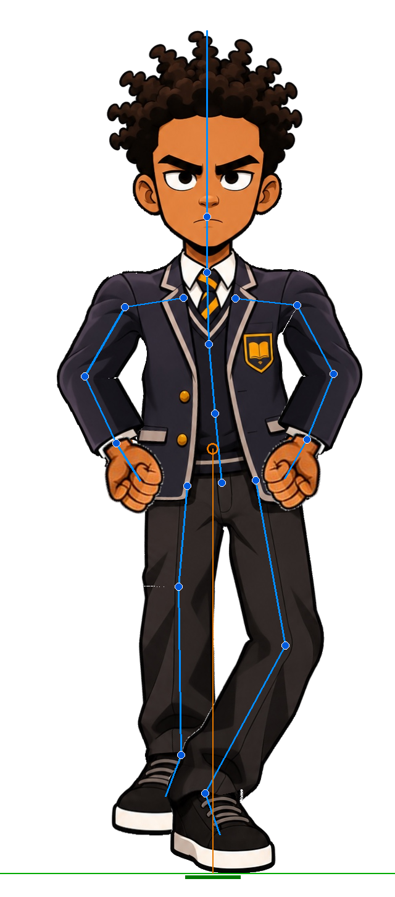

# Phase 3.1 motion audit: why the Phase 3 poses look stiff

This audit was done before changing any code. It covers the posing and deformation code used by the Phase 3
editor:

* `src/autorig/phase2/skeleton.py`, `skinning.py`, `posing.py`, `pose_eval.py`, `natural.py`, `corrective.py`;
* `src/autorig/editor/posesvc.py`.

All numbers come from the user's real T-pose package (`projects/schoolboy_tpose/character_package`, canvas
1086 × 1448), rendered through the editor's `PoseService`. No running-pose screenshot from the Mac was in the
workspace, so the running pose was reproduced from the same code and data the Mac editor uses.

*Phase 3 "running" preset, before Phase 3.1 (preview renderer, not Moho). Blue: bones; orange: centre of mass;
green: ground and support.*

## 1. Inventory of the existing system

| # | Area | What exists | Where |
|---|---|---|---|
| 1 | Skeleton and parenting | 19 bones: pelvis (root) → spine → chest → neck → head; chest → clavicle → upper arm → forearm → hand; pelvis → thigh → shin → foot | `skeleton.py:272-352` |
| 2 | Forward kinematics | Local rotation per bone about its rest pivot, composed root-first; one root translation | `skinning.py:115-149` |
| 3 | Inverse kinematics | Analytic two-bone IK for planted legs and for arm "reach" targets | `posing.py:121-135, 250-258, 268-280` |
| 4 | Pivots | Phase 1 joints refined against the artwork: armpit search for the shoulder, limb re-centring | `skeleton.py:310-347, 364-389` |
| 5 | Rotation limits | One global table per bone kind, applied by clamping | `skeleton.py:45-56`, `posing.py:201-205` |
| 6 | Presets | 12 static `Preset`s of per-joint angles (abduction, flexion, stance width, weight split, scale) | `posing.py:36-117` |
| 7 | Limb lengths | Exact for rigid bones; **axial scaling allowed** (`Preset.scale`, `fk.thigh_scale`) | `skinning.py:131-149, 166-177` |
| 8 | Pelvis and spine compensation | Pelvis height from leg reach; horizontal pelvis shift until the CoM sits over a weighted support point; chest counter-rotation `-0.8 × (pelvis + spine)` | `posing.py:164-198, 221-234` |
| 9 | Foot placement | Targets at `midline ± stance × hip_sep / 2` on the rest ankle line; a free foot is posed by FK | `posing.py:207-216, 236-260` |
| 10 | Layer-to-bone relation | Each pixel has a *home bone* chosen by position (joint planes, body zones), not by layer | `skeleton.py:171-206` |
| 11 | Clothing | No garment model. Clothing pixels behave like the body under them; blend bands per bone kind | `skeleton.py:37-41, 209-243` |
| 12 | Rendering order | `natural_order`: legs, then pelvis/neck/torso, arms, then the head; preset "front" overrides | `natural.py:48-70` |
| 13 | Foreshortening | Axial scale of a bone's own pixels; descendants translated | `skinning.py:131-149` |
| 14 | Corrective geometry | Hand switch drawings (from the character sheet, pending review), per-pose armpit gussets (generated, pending review) | `corrective.py:162-268` |
| 15 | Quality scoring | Joint limits, bone length, ground, CoM, seams, Jacobian stretch/fold, rigid share. Confidence = `0.9 − 0.2 × needs_artwork − 0.08 × defects` | `pose_eval.py:23-152` |
| 16 | Live controls | Readiness panels only; posing has no body/face channel separation | `editor/readiness.py`, `posing.py` |

## 2. The running pose, measured

`PoseSolver.solve(PRESET_BY_NAME["running"])` on the real package:

| Quantity | Value |
|---|---|
| Preset | `weight_left=1.0, stance=0.9, pelvis_tilt=-5, pelvis_drop=0.05, knee_min_bend=14`, right leg free with `thigh_abd=5, knee_flex=6, thigh_scale=0.6`, arms `abduction 30/28, flexion 55/50`, hands `fist` |
| Pelvis shift | +76.8 px sideways, +17 px down |
| Right (free) leg | hip (563, 776) → knee (549, 938) → ankle (554, 1211); thigh drawn **163 px** long instead of 272 |
| Left (stance) leg | hip (675, 766) → knee (723, 1034) → ankle (592, 1273); knee bent **38.8° laterally** |
| Shoes | right ankle x 554, left ankle x 592 (38 px apart); the two shoe layers overlap by **3,297 px** |
| Arms | anatomically symmetric (30°/55° and 28°/50°): both forearms fold toward the hips; no arm/leg opposition |
| Hands | `hand_r__fist`, `hand_l__fist` used although both are `pending_review` |
| Status | NEEDS_ARTWORK, confidence 0.62 = 0.9 − 0.2 (one needs-artwork item) − 0.08 (one defect) |
| Render cost | solve 5 ms; artwork render 1.9 s; engine build 2.6 s (cloud CPU) |

## 3. Confirmed defects

Each item below is reproducible with the code and data named. Phase 3.1 adds tests that would fail if it came
back.

| ID | Symptom reported | Confirmed cause | Evidence |
|---|---|---|---|
| C1 | Legs crossing | Foot targets come from `stance × hip_sep` (`posing.py:213`), ignoring shoe size. Running uses `stance 0.9` (100 px), but the shoes are 167–171 px wide and each reaches 54–57 px medially from its ankle. Any separation under about 115 px overlaps them. | 3,297 px shoe overlap; ankles 38 px apart |
| C2 | Wrong weight distribution and balance | `weight_left=1.0` makes the balance loop (`posing.py:179-191`) push the pelvis 77 px over the left foot target. That target stays near the midline (592), so the stance leg runs diagonally from hip x 675 to ankle x 592. IK then bends the knee laterally by 38.8° (`posing.py:254`), which reads as a bow-legged single-leg stance, not a run. | `pelvis_shift_px [76.8, 17.0]`; `shin_l_flexion 38.8` |
| C3 | Axial scaling used for depth; proportions change | The running preset scales the free thigh to 0.6 (`posing.py:98`, `skinning.py:131-149`). Its pixels are squashed along the bone, so the thigh drawing becomes 40 % shorter while the shin stays full length. | thigh 163 px vs 272 px; `foreshortened forward thigh (approximated by axial scaling 0.6)` |
| C4 | Arms unnatural while running | The arms are set by fixed per-side angles. Both forearms bend toward the midline by the same amount, with no opposition to the legs and no phase. | `upper_arm_r/l_abduction 30/28`, `forearm_r/l_flexion 55/50` |
| C5 | Stiff, mechanical; no gait | `Preset` (`posing.py:36-59`) has no notion of time or phase. "Running" is a single static frame: weight on one leg, the other foot lifted. There is no contact, passing, flight or recovery, and no vertical oscillation. | dataclass fields; one frame per preset |
| C6 | Clothing moves rigidly with joints | There is no garment model. The segmentation cut the bottom of the blazer hem (the beige trim at y ≈ 770–790) into the **thigh** layers. Home bones are chosen by position below the hip line (`skeleton.py:195-206`), so those hem pixels follow the thigh: 9,792 of 10,327 top-of-thigh pixels on the right, 9,657 of 10,174 on the left. The rest of the blazer skirt (pelvis layer) is rigid with the pelvis, with no lag. | `audit_layer_split.png`; home-bone counts |
| C7 | Poor shoulder, elbow, hip and knee deformation | Blend bands are fixed per bone kind (`skeleton.py:37-41`) and do not depend on how far a joint rotates. Large rotations concentrate in the same narrow band: in the running render the upper-arm layers compress 7–8 % of their pixels (`det < 0.45`) and fold 0.3–1.1 % (`det ≤ 0.05`); the stance shin stretches 1.4 % (`det > 2.2`). | `render["stats"]` |
| C8 | Missing hand artwork | `natural_order` swaps in a hand switch drawing whenever the file exists (`natural.py:61-66`). It never checks approval, so pending-review fists are rendered as if approved. | render order lists `hand_r__fist` |
| C9 | Confidence 0.62 means little | The confidence is a formula of defect counts (`pose_eval.py:147`). It is not a visual measure, and it reaches 0.9 for any pose with no counted defects. | formula |
| C10 | Not interactive | Each preview renders all layers with a per-pixel inverse solve (1.9 s), after a 2.6 s engine build when the skeleton or masks change. The skeleton solve (5 ms) is never sent to the browser on its own. | profile in §2 |
| C11 | No body/face channel separation | A head rotation comes from the preset or from a direct override. There is no composition of a live head channel over a body pose. | `posing.py:164-171`, `posesvc.render` |
| C12 | Rest pose is a wide T-pose stance | The reference legs are spread ±18° (ankles 442 px apart; hips 111 px apart). Every standing preset must narrow the stance, which raises the pelvis by up to `L(1 − cos 18°) ≈ 27 px`. That height was never constrained against foot contact in single-support poses. | bone table (`rig.json`) |

## 4. Hypotheses (not confirmed by this audit)

| ID | Hypothesis | How Phase 3.1 tests it |
|---|---|---|
| H1 | Part of the "stiffness" is the lack of secondary motion (blazer hem, hair). | Visual comparison of gait frames with and without hem lag |
| H2 | Shoulder compression (`det < 0.45` on 8 % of the upper-arm layer) is visible as a pinched sleeve at large abduction. | Close-ups of the shoulders before and after rotation-dependent bands |
| H3 | Clavicle rotation without scapulohumeral rhythm makes raised arms look disconnected from the chest. | Arm-raise close-ups and the armpit seam count |
| H4 | Elbow and knee pivots placed at a midpoint (Phase 1 had no detected bend) are off by a few pixels. | Visible only in strong bends; left to the user's pivot review in the editor |

## 5. Constraints that follow from the art

* The reference is a **front view**. Running, walking and leaning in depth are motions *toward* the viewer. A
  front view can show them only through foreshortened drawings (knee-up thighs, tucked shins, shoe soles,
  leaning torsos). None exist. Phase 3.1 must therefore:
  * define a front-view gait that uses in-plane motion only (weight shift, pelvis roll, vertical oscillation,
    foot lift through a limited lateral knee bend, arm swing);
  * report anything deeper as NEEDS_ARTWORK, never as a scaled approximation.
* The fist, pointing, palm-up and thumbs-up hands come from the user's character sheet but are pending review.
  They may be previewed, but a pose that needs them is not SUPPORTED until they are approved.
* The blazer, sweater and trousers are separable only roughly by colour: the blazer is navy (b − r > 0), the
  trousers warm charcoal (b − r < 0), and the trim beige. Garment regions are therefore estimates, shown in
  the diagnostics, and must not change any original pixel in the neutral pose.
