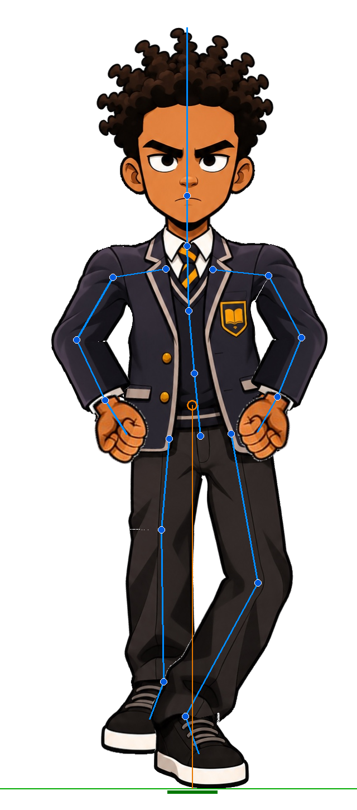
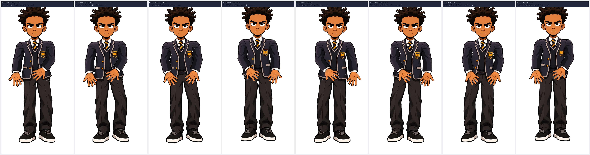
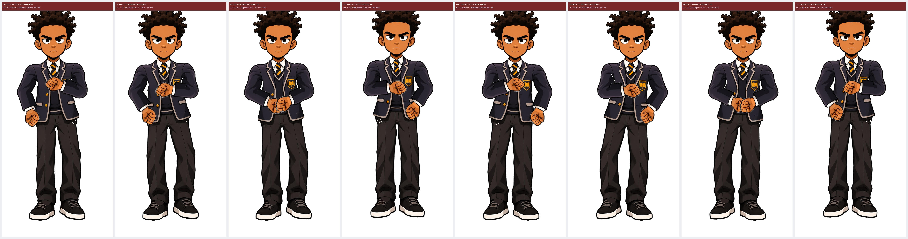
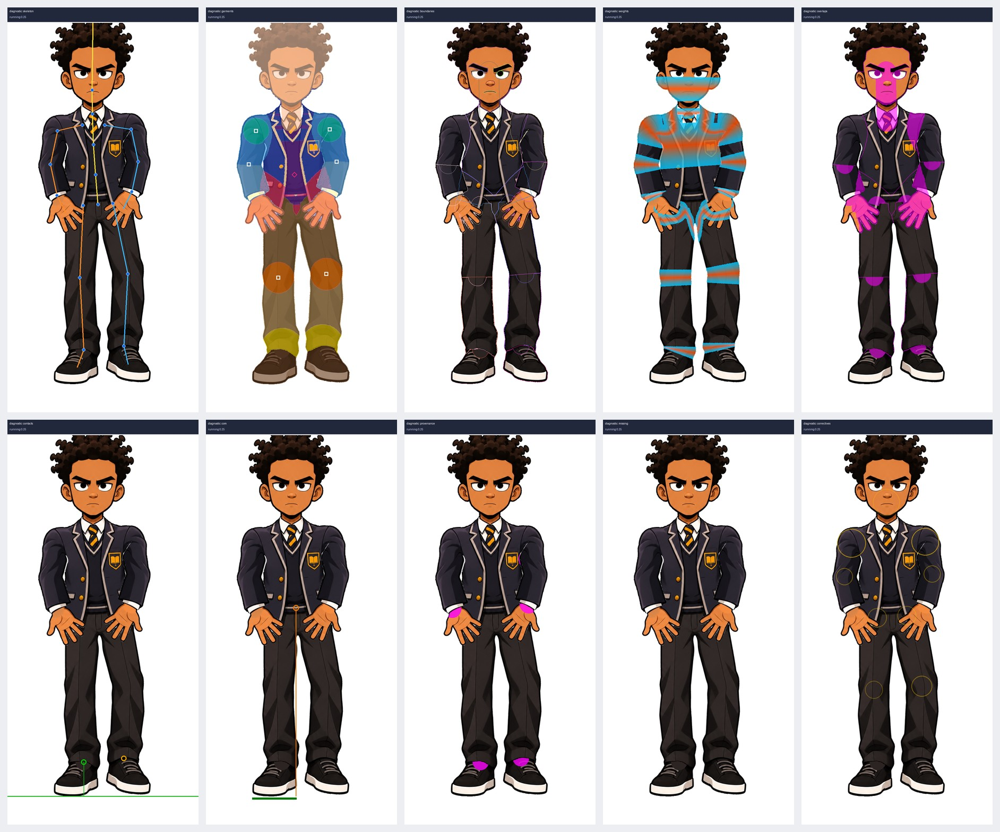
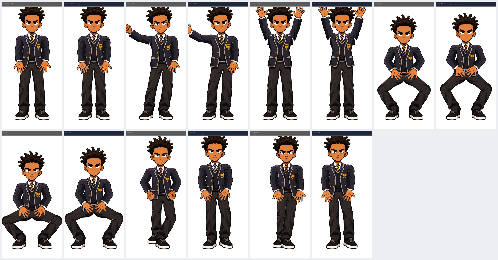
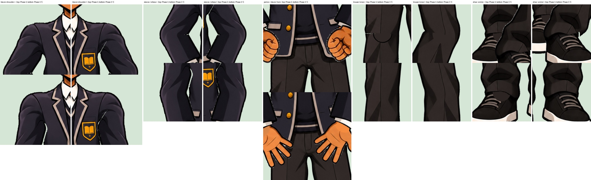
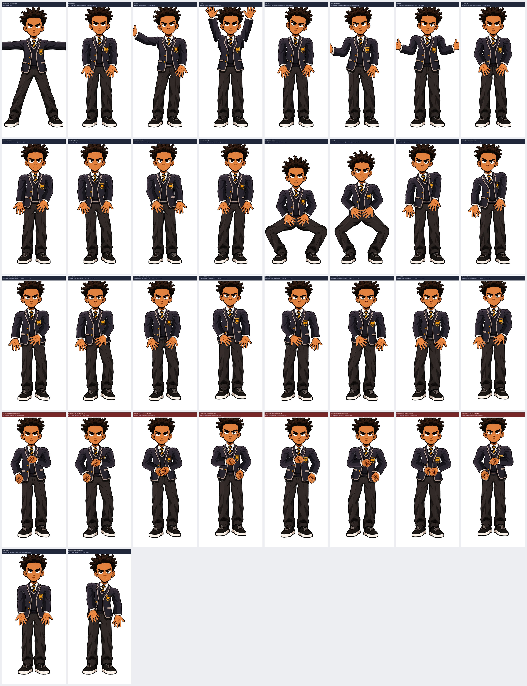
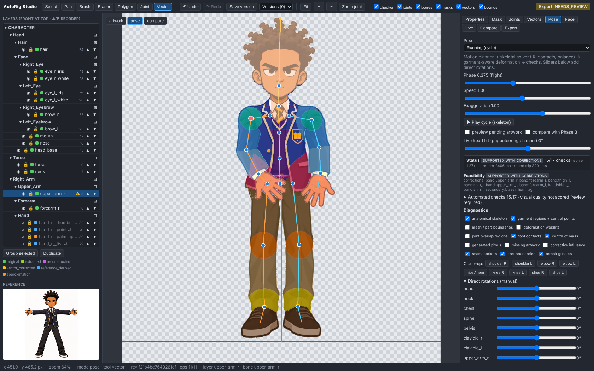

# Phase 3.1 report: natural motion, anatomical rigging and clothing deformation

**Verdict: PARTIAL** (section 14). The running pose no longer crosses the legs, scales the thigh, bows the stance knee
or folds the arms over the hips. The run is now a phase-driven cycle with contact, passing, flight and recovery that
passes every measured gait check. The blazer hem no longer follows the thighs. But this is a **front-view** character,
so a full knee drive needs drawings that do not exist. Arms lowered from the T-pose still compress the armpit beyond the
threshold. Nothing has been reviewed by a person, and Moho has not run.

All results are from the preview renderer on the user's real T-pose package
(`projects/schoolboy_tpose/character_package`). Nothing here is a Moho render.

## 1. Root causes of the old deformation problems

The full audit is in [phase3_1_motion_audit.md](phase3_1_motion_audit.md). The confirmed causes:

| Symptom reported | Confirmed cause (Phase 3 code) |
|---|---|
| Legs crossing | Foot spacing came from `stance × hip width`; running used 0.9 × 111 px, but the shoes are 167–171 px wide, so they overlapped by 3,297 px |
| Wrong balance, stiff stance | `weight_left = 1.0` pushed the pelvis 77 px over a foot target that stayed near the midline; the stance knee bent 38.8° sideways (bow-legged) |
| Axial scaling, proportions changing | The free thigh was scaled to 0.6 (drawn 163 px instead of 272 px) |
| Arms unnatural while running | Both forearms bent inward by the same angle: no phase, no opposition |
| Mechanical, no gait | A preset was one static frame of joint angles |
| Clothing rigid | No garment model; the segmentation put the bottom of the blazer hem into the thigh layers, so it swung with the legs |
| Poor joint deformation | Blend bands fixed per bone kind, independent of the joint angle |
| Missing hands | Pending-review fists were rendered as if approved |
| Confidence 0.62 | A formula of defect counts, not a measurement |



## 2. Architecture changes

`src/autorig/motion/` separates the four systems the request asked for:

```
MotionPlanner ──PoseIntent──> SkeletalPoseSolver ──PoseParams──> ArtworkDeformationEngine ──render──> PoseQualityEvaluator
 (planner.py)   (intent.py)     (solver.py)                       (garments.py)                      (quality.py)
      │                              ▲                                   ▲
      └── PoseFeasibilityEvaluator (feasibility.py): what the available artwork supports
CharacterProfile (profile.py): proportions and constraints measured from this character
MotionEngine (pipeline.py): wiring, caching, diagnostics, evidence, CLI
```

* **MotionPlanner** decides what the character does: foot targets and contacts, hand targets or arm shape, pelvis
  path, torso and head intent, garment hints, required artwork. It contains no bone rotations.
* **SkeletalPoseSolver** turns that intent into rotations under the character's limits (section 3).
* **ArtworkDeformationEngine** is the Phase 2 skinning deformer driven by a garment-aware skeleton (section 5). The
  identity pose stays bit-exact (tested).
* **PoseFeasibilityEvaluator** and **PoseQualityEvaluator** report what is supported and what the render measures.

Compatibility:
* `rig.json`, the editor project schema and the Phase 2 modules are unchanged. The old `PoseSolver` is kept for the
  before/after comparison.
* The editor's Pose tab now uses the new engine, and "rest" still uses manual rotations.
* Gate 10 of the export reads the new results when they exist.

## 3. Skeletal solver improvements

| Requirement | Implementation |
|---|---|
| Forward kinematics | `solver.Kinematics`: rotations about rest pivots, root translation |
| Two-bone IK | Legs (lateral knee preference) and arms (`reach` or world `target`, elbow "down" / "out") |
| Fixed segment lengths | Bones are only rotated; `PoseParams.scale` is always 1 (tested for every preset and 64 run phases) |
| Joint limits | Per character (`CharacterProfile.limits`, overridable), plus front-view knee limits: stance 10°, swing 18°, relaxed leg 18°, squat 75° |
| Shoulder and clavicle | Scapulohumeral rhythm: +0.33° clavicle per degree of abduction above horizontal; −0.045° per degree below |
| Torso rotation and lean | Pelvis roll, spine bend, chest counter-roll (`chest_counter`) |
| Pelvis translation and rotation | Static: lateral shift until the CoM is over the weighted support. Gaits: planned sway, roll and bob |
| Ground contact | Standing height = highest pelvis at which every loaded planted foot still reaches its target with a soft knee. Gaits blend this by foot load, so weight transfer is continuous |
| Swing legs | Knee follows a smooth schedule (it would snap near full extension if derived from distance), with a ground-clearance guard |
| Ankle orientation | Planted shoes stay flat (≤ 3°); swing shoes follow 35 % of the shin |
| Centre of mass | Pixel-mass per home bone, reported for every frame |
| Left/right coordination | Arms swing in opposition to the legs (measured correlation 1.00 on the solved forearms) |
| Live head channel | `compose_live_head` adds a tilt to the neck and head only; body joints are unchanged (tested); head turns are reported as needing artwork |

## 4. Running gait implementation

The run is a normalised cycle, phase 0 → 1, with right-foot contact at 0 and left-foot contact at 0.5.

* **Phases:** stance takes 30 % per foot at speed 1. The rest is contact, passing (mid-stance), flight and recovery
  (swing).
* **Pelvis:**
  * lateral sway over the stance foot (16 % of the track);
  * roll of 5°: the swing hip lifts (see the note below);
  * flight rise of 5 % of leg length, measured at 24.5 px peak to trough;
  * slight compression in stance.
* **Arms:** swing in opposition. There are two styles:
  * **open hands:** the approved art; hands stay low beside the hips;
  * **fists:** used only when fists are approved, or previewed with *preview pending artwork*; the forearm folds up
    toward the chest.
* **Feet:** stance feet are world-locked (sliding 0.0 px). Swing feet follow a smooth lift profile on a track
  wide enough that the shoes never touch (`track_min` = medial shoe extents + 6 px).
* **Speed** (0.5–1.6) shortens the stance and enlarges the amplitudes. **Exaggeration** (0–1.6) scales sway, roll,
  bob, arm swing and lift; above 1, the swing-knee limit rises to 28°.
* **Moving vs in place:** the moving cycle advances the root and locks planted feet in world space (tested with
  40 px per cycle). For a front view the real travel is toward the viewer, so the in-plane images are the same.
* **Looping:** phase 1 equals phase 0 (closure 0.0 px). The largest continuity spike is 0.74 px against a 4 px
  threshold.
* **Front-view note.** Stride length and knee drive happen toward the viewer, and a front view cannot draw them
  without foreshortened thighs, tucked shins and visible soles. The supported front-view run is therefore an in-plane
  jog: weight shift, hip hitch, bob, limited lateral knee bend and arm swing. Real running drops the swing hip and
  clears the foot with a sagittal knee bend; the hip hitch is the deliberate front-view substitute. Asking for more
  (exaggeration above 1) lists the missing drawings and makes the pose NEEDS_ARTWORK, instead of scaling a bone.





The walk works the same way with 60 % stance per foot (double support), no flight, 30 % sway and a 2° hip hitch.

## 5. Clothing deformation improvements

`GarmentModel` labels the rest artwork with semantic regions, estimated from skeleton geometry, layer masks and colour
(navy blazer, warm charcoal trousers, beige trim, white shirt):

* blazer body, lapel trim, shirt collar, tie/badge, sweater;
* blazer hem;
* shoulder seams, upper and lower sleeves, shirt cuffs, hands;
* trouser thighs, knees, shins and cuffs;
* shoes, neck, head.

The regions are shown in the *garment regions* diagnostic, are listed in `natural_pose/motion/garments.json` with
their anchors, and can be wrong.

| Rule | Effect |
|---|---|
| Blazer hem hangs from the pelvis | The 9,324 hem pixels the segmentation cut into the thigh layers get a virtual home on the pelvis and no thigh influence |
| Soft trouser attachment | Thigh influence on trouser pixels ramps in over 30 px below the hem and waistband, so the trousers stretch slightly instead of tearing away. The running tear pairs fell from 87–99 to 4–8 |
| Hem secondary motion | A lag rotation about the waist that follows the pelvis roll (2.5° peak in the run). The displacement fades continuously into the trousers below, so no seam opens |
| Rotation-dependent bands | Shoulder (sleeve side only), elbow, hip, knee and neck bands widen with the joint's rotation (gains in `garments.BAND_RULES`): the correction data a Smart Bone action would hold |
| Layering | Shoe under shin (trouser cuff over the shoe), hand under forearm (sleeve over the wrist), legs under pelvis/torso (hem over the trousers) |
| Shoulder girdle | Torso pixels lateral of the neck at shoulder height follow the clavicle; before this, a lowered shoulder left its outline behind |

No original pixel is repainted. The identity pose is bit-exact.



## 6. Corrective artwork requirements

The feasibility evaluator names these assets. Pending-review assets count as missing.

| Pose | Status | Needs |
|---|---|---|
| Running (fist style) | NEEDS_ARTWORK | `hand:fist`, which exists from the character sheet but is pending review. Approving it switches the run to the fist pump (tested) |
| Running (open-hand style) | SUPPORTED_WITH_CORRECTIONS | optional: fists, `thigh_knee_up` and `shin_tucked` drawings for a full knee drive |
| Pointing | NEEDS_ARTWORK | `hand:point` (pending review); alternative: conversational gesture |
| Arm raise | NEEDS_ARTWORK | armpit gussets (generated, pending review): 51 armpit tear pairs without them |
| Sitting | NEEDS_ARTWORK | thighs foreshortened toward the viewer, a seat; fallback shown: wide-knee approximation |
| Leaning forward / backward | NEEDS_ARTWORK | 3/4 or foreshortened torso; fallback shown: side lean |
| Shrugging, hands on hips | SUPPORTED_WITH_CORRECTIONS | optional: palm-up hands, knuckles-on-hip fists (pending review) |
| All arms-down poses | (quality warning) | an arms-down sleeve / armpit corrective: lowering the T-pose arms compresses 7–13 % of the upper-arm layer |

## 7. Before-and-after comparisons



| Running, measured | Phase 3 | Phase 3.1 |
|---|---|---|
| Shoe overlap (legs crossing) | 3,297 px | 0 px in every phase |
| Axial scaling | thigh × 0.6 | none |
| Stance knee | 38.8° lateral bow | ≤ 10° (stance limit) |
| Pelvis shift | 77 px over one foot | ±21 px sway, CoM drift 1.3 px over the cycle |
| Frames | 1 static frame | continuous cycle, 8 phases on the sheet, 64 measured |
| Arms | symmetric fold | opposition, correlation 1.00 |
| Hands | pending fists used as approved | approved open hands; fists only as a labelled preview |
| "Confidence" | 0.62 from a formula | 14–15 of 17 measured checks per frame; visual quality not scored |

Close-ups, top = Phase 3 and bottom = Phase 3.1, cover the blazer shoulders, sleeves/elbows, pelvis + hem, trouser
knees, and shoes/ankles. They are in `natural_pose/motion/closeups/`. For example:



The full contact sheet has rows for:
* the original neutral, relaxed, pointing, arm raise, head tilt, conversational, shrug and hands on hips;
* the walk (4 phases), sitting, squatting and the leans;
* the run (8 phases, open hands);
* the run with pending fists previewed.



## 8. Automated test results

| Suite | Result |
|---|---|
| `tests/test_p31_motion.py` (real package) | **27 passed** |
| Full pytest (all phases) | **367 passed, 2 skipped** (the 2 native Moho tests: **NOT EXECUTED**) |
| Editor end-to-end (Playwright, headless Chromium) | **passed**, including the new Phase 3.1 steps: gait phase, playback, diagnostics, pending preview, before/after, close-up |
| Frontend type check / build | clean; `editor/dist` rebuilt |

The editor screenshots from the end-to-end test (real browser, real package) are in
[docs/phase3/screenshots/](phase3/screenshots/):

| File | Shows |
|---|---|
| `14_run_cycle_flight.png` | run cycle at phase 0.375 (flight) |
| `15_run_diagnostics.png` | skeleton, garment regions, contacts and centre-of-mass overlays |
| `16_run_playback_skeleton.png` | cycle playback with the skeleton-only preview and its fps / latency readout |
| `17_run_fists_pending_preview.png` | pending fists previewed: NEEDS_ARTWORK, missing asset named |
| `18_run_phase3_before.png` | the same frame from the Phase 3 engine (before/after toggle) |
| `19_closeup_knee.png` | knee close-up button |



### Thresholds (`motion/quality.py`, `THRESHOLDS`)

| Check | Threshold | Meaning |
|---|---|---|
| `bone_length_rel` | 0.002 | max relative change of a bone length |
| `axial_scale` | 0 | bones scaled along their axis |
| `joint_limit_violations` | 0 | angles outside the character's limits |
| `planted_ankle_error_px` | 1.0 | weight-bearing ankle vs its target |
| `planted_foot_angle_deg` | 3.0 | planted shoe rotation from flat |
| `ik_error_px` | 1.0 | reachable IK target error |
| `ground_penetration_px` | 1.5 | lowest shoe pixel below the ground line |
| `planted_sole_error_px` | 2.0 | planted sole vs ground line |
| `shoe_overlap_px` | 0 | overlapping shoe pixels (crossing) |
| `com_outside_support_px` | 0 | static: CoM outside the planted shoes |
| `com_outside_feet_px` | 25 | gait frame: CoM outside the ankles' span |
| `exposed_gap_pairs` | 10 | torn pixel pairs showing background |
| `visible_seam_pairs` | 15 | torn pairs where a torn layer is on top |
| `outline_break_pairs` | 12 | torn pairs on outlines |
| `stretched_fraction` | 0.005 | max layer share stretched > 2.2× |
| `compressed_fraction` | 0.06 | max layer share compressed < 0.45× |
| `folded_fraction` | 0.03 | max layer share folded |
| `layer_area_change` | 0.04 | max layer area change (proportions), layers > 3,000 px |
| `loop_closure_px` | 0.5 | phase 1 vs phase 0 |
| `continuity_spike_px` | 4.0 | a joint's step minus its larger neighbouring step (64 samples) |
| `foot_slide_px` | 1.0 | weight-bearing ankle drift within a stance (load ≥ 0.8) |
| `gait_ground_penetration_px` | 1.0 | ankle below standing height in any sample |
| `coordination_corr` | 0.9 | arm forwardness vs the opposite leg |
| `com_drift_px` | 6.0 | in-place cycle: mean CoM vs midline |

A pose that passes every check still has `artistic_review_required: true` and `visual_quality: UNRATED`.

### Results on the real character (`natural_pose/motion/results.json`)

| Gait cycle (64 samples) | Checks | Pelvis range | Airborne samples |
|---|---|---|---|
| Run, in place (open hands / fist preview) | 6/6 | 24.5 px | 24 |
| Run, moving 40 px/cycle | 5/5 | 24.8 px | 24 |
| Walk, in place / moving | 6/6, 5/5 | 1.8 / 2.1 px | 0 |

| Frame | Feasibility | Checks | Failing |
|---|---|---|---|
| Relaxed standing | SUPPORTED_WITH_CORRECTIONS | 15/17 | compressed 0.079, neck area 0.056 |
| Run phases 0–0.875 (open hands) | SUPPORTED_WITH_CORRECTIONS | 14–15/17 | compressed 0.069–0.104, neck area ~0.055; phase 0.25 also 11 gap pairs |
| Run phases (fists previewed) | NEEDS_ARTWORK | 13–15/17 | plus forearm stretch up to 0.016 and folds up to 0.037 at the bent elbow |
| Walk phases | SUPPORTED_WITH_CORRECTIONS | 15/17 | compressed 0.077–0.088, neck area |
| Squat | SUPPORTED_WITH_CORRECTIONS | 14/17 | thigh stretch 0.019, compressed, neck area |
| Arm raise | NEEDS_ARTWORK | 13/17 | 51 armpit tear pairs, stretch 0.029, upper-arm area 0.12 |
| Pointing | NEEDS_ARTWORK | 13/17 | 36 tear pairs, compressed, neck area |
| Side lean (and lean fallbacks) | SUPPORTED_WITH_CORRECTIONS / NEEDS_ARTWORK | 12–13/17 | 21–33 tear pairs |
| Sitting (approximation) | NEEDS_ARTWORK | 13/17 | thigh stretch 0.050, folds |

Two checks fail in almost every pose and are reported, not hidden:
* **`compressed_fraction`:** the T-pose armpit folding when the arms come down.
* **`layer_area_change` on the `neck` layer:** about 5.5 %. Its cause has not been isolated yet.

## 9. Visual inspection results (assistant's review of the rendered images, not the user's)

* **Running:** legs no longer cross or bow, and no limb changes length. The body bobs and sways and the hips hitch.
  * Fist preview: reads clearly as running.
  * Open hands: reads as a jog with low hands. The approved art has only a spread open hand, which looks stiff in a
    run.
* **Walking:** mostly a weight shift; a front-view walk without stride art is subtle.
* **Blazer:** the hem stays over the trousers and no longer bends with the thighs. Hem lag is visible but small.
* **Shoulders:**
  * Lowered arms show a compressed armpit and, in some poses, a faint hairline in the armpit crease (15 pairs in
    *hands at sides*).
  * Raised arms tear the armpit corner, which needs the pending gussets.
* **Knees and shoes:** no crease artifact (Phase 3 had one from the scaled thigh). The cuffs sit over the shoes.
* **Hands on hips:** the open hand on the hip is a weak substitute for a knuckles-on-hip fist.

## 10. Performance benchmarks (measured)

| Measurement | Cloud sandbox (4 vCPU) | Apple M1 |
|---|---|---|
| Skeleton solve (`autorig motion-bench`, 200 run phases) | median 1.11 ms, p95 1.21 ms (≈ 900/s) | NOT MEASURED |
| Editor playback, skeleton only (headless Chromium, localhost; 3 runs) | 53–60 fps, 7–15 ms request latency | NOT MEASURED |
| Full artwork render + seam analysis | median 2.5 s per frame | NOT MEASURED |
| Engine build (once per edit state) | 2.4–4.7 s | NOT MEASURED |
| Evidence set (`autorig motion`, 33 renders + 6 cycles) | 109 s | NOT MEASURED |

* The 30 fps target is met **for the skeleton preview** while scrubbing or playing a cycle.
* The artwork is not interactive: it re-renders 350 ms after the controls stop moving.
* The expensive steps (garment model, layer crops, home bones, skeleton) are cached per edit state. Slider moves run
  only the local solver; nothing calls a cloud model.

To measure on the Mac:

```bash
.venv/bin/python -m autorig motion-bench projects/schoolboy_tpose/character_package
```

Then play a cycle in the Pose tab; the panel shows fps and latency. An interactive artwork preview would need GPU
mesh skinning in the browser. It is not built.

## 11. Remaining issues

1. **Front-view limits.** A full knee drive, sagittal leans and sitting need drawings that don't exist. They are
   reported as NEEDS_ARTWORK, with fallbacks.
2. **Armpit compression** when the T-pose arms are lowered (7–13 % of the upper-arm layer), plus hairlines in some
   poses. The fix is an arms-down sleeve / armpit corrective drawing.
3. **Arm raise** tears the armpit; the gussets exist but are pending review.
4. **Neck layer area +5.5 %** in every posed frame: measured, cause not isolated.
5. **Garment regions are estimates** (colour + geometry). The sweater/trouser centre and the lapels may be
   mislabelled in places; check the garment overlay.
6. **The run arm style depends on approval.** Open hands give a weaker run; approving the fists gives the pump style.
7. **Not real-time:** the artwork render is 2.5 s, and the M1 is not measured.
8. **Nothing has been reviewed by the user,** and Moho has not run. Phase 0 is still unverified.

## 12. Moho compatibility implications

* `rig.json`, bone names, the hierarchy and the editor schema are unchanged. The export manifest still validates.
* `deformation.garments` and `deformation.motion_profile` carry the garment regions and anchors, the
  rotation-dependent band rules (driver joint, gain, full range), the hem-lag rule and the layering rules. All are
  marked `proposed_unverified`.
* These map naturally to Moho bone strength, Smart Warp falloff and Smart Bone actions (driver angle → corrective
  shape). No Moho API was used or invented, and nothing was checked in Moho.
* Gaits are deterministic functions of phase, so a Phase 4 importer can bake them into keyframes per frame.

## 13. Live puppeteering compatibility

* **Channels are separate.** Body poses come from the planner/solver. The live head channel adds tilt to neck and head
  only and leaves all body joints unchanged (tested). This means a live head can be layered over a body cycle.
* **Head turn** is refused with a REQUIRES_NEW_ARTWORK note. **Facial controls** are untouched.
* **Webcam tracking** was not implemented, and no SHOWTIME input identifiers were invented.

## 14. Verdict: PARTIAL

**Achieved, with evidence:**
* a planner/solver/deformation/evaluator architecture;
* a phase-driven front-view run and walk that pass every gait check;
* no leg crossing, axial scaling or proportion change;
* a blazer hem that hangs from the pelvis;
* rotation-dependent joint corrections;
* an artwork-aware feasibility evaluator that never treats pending art as approved;
* measured checks with documented thresholds;
* editor diagnostics, a before/after view and skeleton playback at 53–60 fps (cloud).

Tests: 27 Phase 3.1 tests and 367 tests in all pass, plus the browser end-to-end test; the 2 native Moho tests are
NOT EXECUTED.

**Not achieved:**
* *Production quality.* Arms-down shoulders still compress beyond the threshold, the neck layer area grows 5.5 %, and
  several poses need drawings that do not exist.
* *Review and native evidence.* Nothing is visually approved by the user, Moho has not run, and the M1 performance is
  not measured.
* *Interactivity.* The artwork preview is not interactive.

Phase 4 has not been started.
