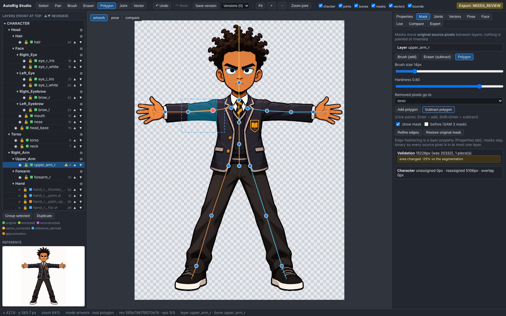
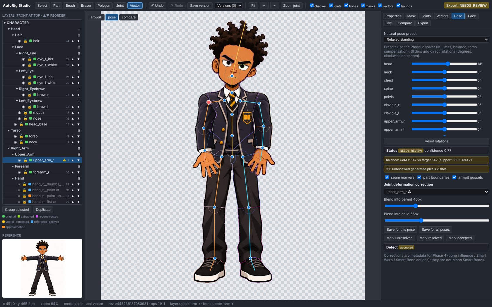

# Phase 3 report: interactive artwork editor, hybrid assembly and rig preparation

**Verdict: PARTIAL** (see section 15). The editor works on the user's real T-pose character in a real
browser, edits persist, and a validated Moho-ready asset package is exported. Phase 0 is still not verified
in Moho, nothing generated has been reviewed by a person, and the exported package is correctly marked
`production_ready: false`.

Scope reminder: Phase 3 is the editor and asset assembly. The native Moho rig is Phase 4 and was not started.

## 1. Implementation summary

| Deliverable | State |
|---|---|
| Audit of earlier phases and implementation plan | [docs/phase3_implementation_plan.md](phase3_implementation_plan.md) |
| Backend: event-sourced editor project, derived artwork, pose service, vectors, readiness, export, quality gates, HTTP API | `src/autorig/editor/` (7 modules) |
| Browser editor: React 19 + TypeScript + Vite + react-konva | `editor/` (built copy committed in `editor/dist/`) |
| CLI | `autorig editor <package>` and `autorig export-assets <package> --out <dir>` |
| Validated asset package for the real character | `projects/schoolboy_tpose/moho_asset_package/` (0 validation errors; not production-ready) |
| Tests | 18 new pytest, 11 vitest, 1 Playwright end-to-end test (11 steps) with 13 screenshots |
| Real-browser screenshots | `docs/phase3/screenshots/` (generated by the end-to-end test) |

The browser test found five real defects in the editor, plus one bug in the test itself. A review found one
safety problem. All of them are fixed (section 6.4).

## 2. Architecture

```
reference + Phase 1 project + Phase 2 package (read-only)
        |
        v
 EditorProject (project.json: op log + cursor, versions/vN.json)   <- every edit is an operation
        |  replay
        v
 state  --> ArtworkModel (masks = base partition + mask ops, layer RGBA, composite, fidelity, provenance)
        --> PoseService (Phase 2 skeleton/skinning/PoseSolver/evaluate, with edited bones and limits)
        --> readiness (face_panel, live_panel)        --> export_package + quality_gates
        |
 FastAPI (server.py) <-- JSON/PNG -->  React + Konva editor (editor/src)
```

* **Non-destructive by construction.** The package's source image, Phase 1 layers, Phase 2 originals and
  extensions are only ever read. Edits are operations in `<package>/editor/project.json`, written atomically.
  Derived pixels are computed from the source on demand.
* **Partition invariant.** Each source pixel belongs to at most one layer. A mask edit moves source pixels
  between layers (or into "unassigned", which is reported as a gap). It never paints or invents pixels.
* **One pose solver.** `posesvc.py` builds the Phase 2 natural-pose skeleton, overrides it with the edited
  bones, and runs the existing `Deformer`, `PoseSolver` and `evaluate`. The only change to Phase 2 is
  `PoseSolver.limit_overrides`, so user-edited rotation limits reach the same solver.
* **Coordinates.** Everything is in source pixels (origin top-left, +y down). The canvas applies only a view
  transform. The export adds Moho-frame coordinates (origin at the frame centre, +y up, frame height spans
  [-1, 1]) and Moho angles (radians, CCW, parent-relative). It records the formulas in the manifest.

## 3. Frontend

| Area | What it does |
|---|---|
| Layout | Toolbar (tools, undo/redo, save version, versions menu, fit/zoom, overlay toggles, export readiness badge); left: layer hierarchy and the original reference; centre: canvas with artwork/pose/compare modes; right: nine tabs; status bar (cursor in source px, zoom, revision, op count, selection, errors) |
| Canvas (Konva) | Zoom at the cursor (wheel), pan tool, fit to screen, zoom to joint, checkerboard, pixel-accurate selection (alpha test of the layer under the cursor), layer bounds, tinted mask overlay, skeleton (joints, bones coloured by side, tail handles), vectors with anchors and Bezier handles, seam markers, part boundaries |
| Layers | Group tree with front-most at the top, visibility, lock, category colour (original / extracted / reconstructed / vector_corrected / reference_derived / approximation), mask warnings, reorder, group, ungroup, duplicate |
| Keyboard | Cmd/Ctrl+Z undo, Shift+Cmd/Ctrl+Z or Ctrl+Y redo, V H B E P J N tools, F fit, Enter / Shift+Enter close polygon (add / subtract), Esc cancels a polygon |
| Unit tests | `editor/src/geometry.test.ts`: screen/image mapping, zoom anchoring, fit, brush radius, Bezier path data, node and handle moves, hierarchy tree, pixel cache key |

Loading is incremental. Layer PNGs are cached by a key that changes only when mask edits or rejections change
pixels. Bone, vector, pose and approval edits do not reload the 33 layer images, and the previous image stays
visible until its replacement has loaded. The production bundle is 600 kB of JS (183 kB gzipped).

## 4. Backend

| Module | Responsibility |
|---|---|
| `project.py` | Schema `autorig.editor_project` v1. Base state built from the package: 33 layers (25 bitmap + 8 corrective hand switch layers), groups, 19 bones from `natural_pose/rig.json`, vectors, approvals. 20 operation types, validated before entering the log; locked layers protected. Undo, redo (a new op truncates the redo tail), named versions, restore, migration (refuses newer schemas) |
| `artwork.py` | Base masks from Phase 2 originals; brush (radius × hardness), polygon, refine (open/close; removed pixels go to the neighbour with most contact), reset; layer RGBA; composite; mask validation (unassigned, overlap, reassigned, per-layer warnings); fidelity; diff heatmap; provenance overlay |
| `posesvc.py` | Edited skeleton (parent ordering, clavicle zones, blend bands: bone → joint correction → per-pose correction), cached engine, rest pose with manual rotations or a named preset, tears, gussets, evaluation; joint/hierarchy warnings |
| `vectors.py` | Phase 2 SVG circles and polylines seeded as editable Bezier paths; path data and SVG writer; parser (round-trip tested) |
| `readiness.py` | Face features, anchors and capabilities from the Phase 2 live artwork manifest; live controls, gamepad gestures. Nothing is upgraded without artwork, and `live_ready` is always false |
| `export.py` | Package writer, 12 quality gates, independent `validate_package` |
| `server.py` | 18 routes (project, op, undo, redo, versions, source/layer/mask PNGs, comparison PNGs and metrics, presets, pose, face, live, gates, export); serves `editor/dist` |

Edits are persisted on the backend after every operation (no reliance on browser storage).

## 5. Editing capabilities

| Requirement | Implementation | Verified by |
|---|---|---|
| Select, reorder, show/hide, lock, opacity, group, duplicate | `layer.*`, `group.*` ops | pytest (persisted after reopen); browser (click selection, reorder, visibility) |
| Mask correction: brush, eraser, size, hardness, polygon, add/subtract, transfer target, refine, restore, before/after, validation | `mask.edit` / `mask.refine` / `mask.reset` | pytest (partition, no overlap, exact neutral after transfer, gap when no target); browser (polygon-subtract with transfer, brush stroke) |
| Joint/pivot editor: drag pivot and tail, numeric fields, parent, limits, reset to analysed | `bone.set` / `bone.reset` | pytest; browser (drag the shoulder pivot; checked within 2.5 px) |
| Joint warnings: hierarchy, missing parent, cycle, zero length, outside the artwork, implausible length, left/right mismatch, extreme limits, missing bindings | `bone_warnings` | pytest covers each warning |
| Hybrid bitmap/vector: create, drag anchors and handles, fill, stroke, closed, approve/reject | `vector.*` ops | pytest (round-trip, origin protected); browser (create, drag an anchor) |
| Pose preview: presets, direct joint rotation, seam markers, part boundaries | `/api/pose` → Phase 2 solver | pytest (identity pose bit-exact); browser (two presets, head rotation) |
| Joint deformation correction: blend bands per joint, global or per pose, gussets on/off, defect status | `correction.*`, `defect.set` | pytest; browser (save for this pose, mark accepted) |
| Facial feature editor: features, pixels, anchors, approvals, capability readiness | `face_panel` | pytest; browser |
| Live readiness | `live_panel` | pytest; browser (no control claims live-ready) |
| Comparison: split, overlay, diff heatmap, provenance, reference, fidelity metrics, sign-off | `/api/compare/*` | pytest; browser |
| Persistence: op log, undo/redo, versions, migration, reopen | `EditorProject` | pytest; browser (server restarted, page reloaded, edits present) |

Joint corrections are metadata for Phase 4. The editor says, in the UI and in the manifest, that they are not
Moho Smart Bones.

## 6. Tests

### 6.1 Results (this commit, cloud sandbox)

| Suite | Result |
|---|---|
| Full pytest (all phases) | **340 passed, 2 skipped** (the 2 skipped are the native Moho tests: **NOT EXECUTED**) |
| Phase 3 pytest `tests/test_p3_editor.py` | 18 passed (on a copy of the real T-pose package) |
| Frontend unit tests (vitest) | 11 passed |
| Playwright end-to-end (`editor/e2e/editor.e2e.mjs`, headless Chromium) | 1 passed: 11 steps, ~80 s |
| TypeScript (`tsc -b`, strict) | clean |

### 6.2 What the end-to-end test does

It starts the real backend on a scratch copy of the real package and drives a real browser. After each step it
checks the **persisted** result through the API or on disk, not just the UI:

1. Load the project and the reference; click the forearm on the canvas and check the selection.
2. Reorder a layer and toggle visibility. Moving `forearm_r` in front of `hand_r` must be detected as a
   fidelity regression (gate 9 FAIL, diff heatmap); moving it back must restore an exact neutral.
3. Draw a 4-point polygon and subtract it from `upper_arm_r` with transfer to `torso`. Check: one mask op,
   more than 1,000 px reassigned, 0 unassigned.
4. Paint a soft brush stroke and check that it was stored.
5. Drag the shoulder pivot by (+12, −4) px and check the stored head position and the `edited` flag.
6. Create a vector shape, drag an anchor by (+15, +6) px, and check the stored node.
7. Preview presets and a +14° head rotation; save a per-pose band correction; mark the defect accepted; show
   part boundaries.
8. Face and Live tabs: blinks are REQUIRES_NEW_ARTWORK, and no control claims to be live-ready.
9. Compare: split and provenance views; neutral fidelity is exact; record the sign-off.
10. Undo and redo; save a version; restart the server and reload the page. Bones, mask ops, vector and version
    are all still there.
11. Export from the UI: 0 validation errors, `production_ready` false; the source image hash is unchanged; no
    page errors.

### 6.3 Backend test coverage

Loading, layer ops and validation, z-order fidelity detection, mask transfer, refine and reset, gaps without
a transfer target, invalid ops, every joint warning, cycle refusal by the pose service, vectors, pose preview
(identity pose bit-exact with the neutral composite, unknown preset or bone refused, user limits reach the
solver), correction and defect metadata, undo/redo/versions/reopen, migration, face and live readiness,
export validity (source byte-identical, full-canvas layers, rejected generated pixels excluded, no `.moho`
file, originals unchanged), quality-gate blocking, the HTTP API, and refusal to overwrite a non-export
directory.

### 6.4 Defects found by running the editor in a real browser, now fixed

| Defect | Fix |
|---|---|
| Two polygon clicks within 400 ms counted as a double-click, which cleared the polygon | Points are added with a functional state update; a double-click closes only a polygon with 3 or more points |
| The joint list appended "⚠" to the option value of joints with seam warnings, so choosing one selected a bone that does not exist | Explicit option values |
| Every edit reloaded all 33 layer images, so the canvas went blank briefly after any edit | Per-layer pixel cache key; the old image stays until the new one loads |
| A late mask-overlay load could appear in pose mode | Stale loads are ignored; overlays render only in artwork mode |
| The diff heatmap marked the whole background (transparent compared with the reference's white) and was hard to see | The heatmap covers character pixels only; yellow (small) to red (large) error, gaps in magenta, reference dimmed |
| (Safety, found in review) export deleted an existing output directory, and the API accepted any output path | Export replaces only an earlier AutoRig export or an empty directory. The API accepts a plain export name and writes inside `<package>/editor/exports/` |

### 6.5 Running the tests on the Mac

```bash
.venv/bin/pip install -e '.[dev]'
```

```bash
.venv/bin/python -m pytest tests/test_p3_editor.py -v
```

```bash
cd editor && npm install && npm test
```

```bash
cd editor && npm install --no-save playwright && npx playwright install chromium && AUTORIG_PYTHON=../.venv/bin/python npm run e2e
```

The end-to-end test overwrites `docs/phase3/screenshots/` unless `AUTORIG_SHOTS` points elsewhere.

## 7. Real character screenshots

Taken by the end-to-end test in headless Chromium (1680 × 1050) on the user's T-pose character. These are
real browser renders of the editor. None of them is a Moho render.

| File | Shows |
|---|---|
| [01_loaded.png](phase3/screenshots/01_loaded.png) | Real project loaded: layer tree, skeleton, reference viewer, export badge |
| [02_reorder_fidelity_diff.png](phase3/screenshots/02_reorder_fidelity_diff.png) | Diff heatmap at 259 % zoom: the forearm's generated extension covering the hand after a z-order change; badge shows FAIL |
| [03_mask_correction.png](phase3/screenshots/03_mask_correction.png) | Blazer pixels moved from the right upper arm to the torso; validation panel |
| [04_joint_editor.png](phase3/screenshots/04_joint_editor.png) | Shoulder pivot dragged; joint fields, analysed position, warnings |
| [05_vector_edit.png](phase3/screenshots/05_vector_edit.png) | New correction shape with anchors and handles |
| [06_pose_relaxed.png](phase3/screenshots/06_pose_relaxed.png) | Relaxed standing preview |
| [07_pose_arms_raised.png](phase3/screenshots/07_pose_arms_raised.png) | Both hands raised: NEEDS_REVIEW, gussets pending review |
| [08_pose_joint_correction.png](phase3/screenshots/08_pose_joint_correction.png) | Head rotated 14°, per-pose band saved, defect accepted, part boundaries |
| [09_face.png](phase3/screenshots/09_face.png) | Facial features and capability readiness |
| [10_live.png](phase3/screenshots/10_live.png) | Live controls: none live-ready, mappings proposed_unverified |
| [11_compare_split.png](phase3/screenshots/11_compare_split.png) | Split view: editor neutral against the original |
| [12_compare_provenance.png](phase3/screenshots/12_compare_provenance.png) | Provenance: reassigned pixels in cyan; neutral exact |
| [13_export.png](phase3/screenshots/13_export.png) | Quality gates, pending approvals, export result (0 validation errors) |





## 8. Fidelity results

Measured on the real character (canvas 1086 × 1448, character footprint 412,424 px):

| State | Gap px | Max colour error where covered | Neutral exact |
|---|---|---|---|
| Unedited package (and the committed export) | 0 | 0 | **yes** |
| After moving the blazer strip (4,944 px) from `upper_arm_r` to `torso` | 0 | 0 | **yes** (pixels moved, not changed) |
| Subtracting the same region with no transfer target | 4,944 | 0 | no: reported as a gap (gate 8 NEEDS_REVIEW) |
| `forearm_r` moved in front of `hand_r` | 0 | 216 | no: gate 9 FAIL, visible in the diff heatmap |

The last row is a real modelling fact, not an editor bug. Each Phase 2 extension sits under its own original.
If a layer is moved above a neighbour, its generated hidden-part pixels cover that neighbour's original pixels.
Moho layer order behaves the same way, so the editor reports it instead of hiding it.

## 9. Pose preview results

The editor runs the Phase 2 natural-pose solver on the edited skeleton. On the unedited real package, after
the blazer mask correction:

| Pose | Status | Confidence | Gaps / seams / outline breaks | Render (cloud CPU) |
|---|---|---|---|---|
| rest (identity) | OK_PENDING_REVIEW | 0.90 | 0 / 0 / 0 | 2.4 s |
| relaxed_standing | OK_PENDING_REVIEW | 0.85 | 0 / 0 / 0 | 3.5 s |
| hands_at_sides | OK_PENDING_REVIEW | 0.85 | 0 / 0 / 0 | 3.5 s |
| casual_walk | OK_PENDING_REVIEW | 0.85 | 0 / 0 / 0 | 4.1 s |
| natural_squat | OK_PENDING_REVIEW | 0.90 | 0 / 27 / 27 | 3.5 s |
| head_tilt_compensated | OK_PENDING_REVIEW | 0.85 | 5 / 0 / 5 | 4.0 s |
| pointing_speaking | NEEDS_REVIEW | 0.69 | 0 / 0 / 0 | 4.3 s |
| one_hand_shrug | NEEDS_REVIEW | 0.69 | 4 / 6 / 10 | 4.0 s |
| both_hands_raised | NEEDS_REVIEW | 0.74 | 0 / 0 / 0 | 3.9 s |
| conversational_gesture | NEEDS_REVIEW | 0.77 | 0 / 1 / 1 | 4.2 s |
| running | NEEDS_ARTWORK | 0.62 | 1 / 7 / 8 | 4.0 s |
| arms_crossed | NEEDS_ARTWORK | 0.09 | 0 / 20 / 19 | 3.6 s |
| sitting | NEEDS_ARTWORK | 0.05 | 8 / 47 / 55 | 3.6 s |

The identity pose is bit-exact with the neutral composite (pytest). A render takes 2–4 s, so the UI debounces
slider changes (350 ms) and shows "rendering…". Poses are never stretched to pass. The NEEDS_REVIEW statuses
come from corrective artwork pending review and from balance warnings; the NEEDS_ARTWORK poses list the
missing drawings.

## 10. Remaining deformation problems

* **Elbow and knee creases:** `arms_crossed` and `sitting` need corrective drawings that the reference does not
  contain (listed as NEEDS_ARTWORK). The editor records band corrections and defect decisions, but it cannot
  invent the art.
* **Foreshortening:** the running thigh is approximated by axial scaling (0.6), as in Phase 2.
* **Squat seams:** `natural_squat` passes, with 27 seam samples at the hip and knee bends. These need visual
  review.
* **Corrective hand variants and armpit gussets** are still `pending_review`. They render, but they are not
  approved.
* **Pivot accuracy:** joints come from estimates (Phase 1 plus the natural-pose skeleton). Users can now
  correct them, but nobody has.

## 11. Live readiness status

* 15 live controls: 9 REQUIRES_NEW_ARTWORK, 3 REQUIRES_RECONSTRUCTION, 3 NEEDS_REVIEW, **0 READY, 0 live-ready**.
* Facial capabilities: blinks, mouth opening/narrowing, smile/frown and head turn REQUIRE_NEW_ARTWORK; eye
  direction and head tilt NEED_REVIEW; eyebrow movement REQUIRES_RECONSTRUCTION.
* 12 gamepad gestures are proposed from the pose presets, all `proposed_unverified` and not live-ready.
* Webcam tracking is **not implemented** in Phase 3, as instructed. No SHOWTIME input identifiers were invented.

## 12. Moho export readiness

`projects/schoolboy_tpose/moho_asset_package/` (1.5 MB), created with `autorig export-assets` from the unedited
real package:

* `source/original.jpg` (byte-identical, sha256 recorded); 33 full-canvas layer PNGs (25 bitmap + 8 corrective
  hand variants); 5 vector SVGs; `manifest.json` (schema `autorig.moho_asset_package` 1.0.0); and
  `reports/quality_gates.json`.
* The manifest contains: canvas size and Moho-frame formulas; layers (group, z-index, bone, pivot, bounds,
  provenance, generated extensions and their approval); groups; vectors; 19 bones in pixels and Moho
  coordinates with Moho angles; rotation limits and blend bands; deformation corrections and defects (marked
  `proposed_unverified` for Phase 4); facial and live readiness; approvals; the file list.
* `validate_package`: **0 errors**.

| Gate | Level |
|---|---|
| 1 source preserved · 2 layer dimensions · 3 coordinate alignment · 4 referenced assets · 5 bone hierarchy · 6 joint positions · 7 layer bindings · 8 neutral gaps · 9 original preservation | PASS |
| 10 unresolved deformation defects (7 presets not OK and not accepted) | NEEDS_REVIEW |
| 11 facial artwork completeness (6 capabilities need new artwork) | NEEDS_REVIEW |
| 12 mandatory approvals (25 pending, including the neutral-fidelity sign-off) | NEEDS_REVIEW |

**`production_ready: false`.** A pytest shows that even with every approval recorded, gate 11 keeps the
package from being production-ready, because the facial artwork does not exist. No `.moho` file is generated:
the Phase 0 importer is still not verified in Moho.

## 13. Outstanding issues

1. **Phase 0 native verification has still not been run** in Moho (NOT EXECUTED). Phase 4 depends on it.
2. **No human review yet:** 25 mandatory approvals are pending (generated extensions, corrective hands and
   gussets, Phase 2 vectors, neutral sign-off).
3. **Missing artwork:** closed eyes, mouth shapes, head turns, and elbow and knee creases.
4. The blazer-in-upper-arm segmentation issue is fixable in the editor (demonstrated), but the committed
   package is unedited, because that decision belongs to the user.
5. Pose preview is CPU-bound (2–4 s per render). It is fine for review, not for scrubbing.
6. The editor has been tested in headless Chromium only. Safari and Firefox on the Mac are untested. Only the
   mouse is tested (no pen/tablet pressure).
7. The z-order rule (a moved layer's extension can cover a neighbour) is detected but not prevented. Phase 4
   should keep the export's z-order or re-verify it.

## 14. Phase 4 recommendations

1. Run the Phase 0 native checks on the Mac first ([docs/phase0/manual-verification.md](phase0/manual-verification.md)).
2. Review in the editor: approve or reject each extension, corrective hand and gusset, and sign off the
   neutral pose. Correct masks and pivots where needed, and re-export.
3. Build a Phase 4 importer that reads `manifest.json` (not the editor project), using only allowlisted Moho
   API members. Create image layers at the manifest z-order, bones from `head_moho`/`tail_moho` and
   `moho_angle_rad_parent_relative`, and bindings from `layers[].bone`.
4. Translate blend bands and corrections into bone strength and Smart Warp/Smart Bone actions **only after**
   each API member has an evidence entry. Keep them `proposed_unverified` until Moho has run.
5. Commission or draw the missing artwork listed by gate 11 and the NEEDS_ARTWORK poses before attempting
   Live Models (LM-1).

## 15. Verdict: PARTIAL

**Done:** every Phase 3 component was built and tested on the user's real character:

* The editor runs in a real browser, and edits persist across a server restart.
* The neutral pose stays exact after mask corrections.
* Pose preview reuses the Phase 2 solver.
* Face and live readiness never overclaim.
* A validated asset package was exported.
* Five UI defects found by the browser test are fixed.

**Not done, by design or because it is blocked:**

* Moho has not run: Phase 0 is still unverified, and no `.moho` file was generated.
* No generated pixels have been reviewed by a person.
* Required facial and corrective artwork does not exist.
* The package is therefore not production-ready.

Phase 4 has not been started.
